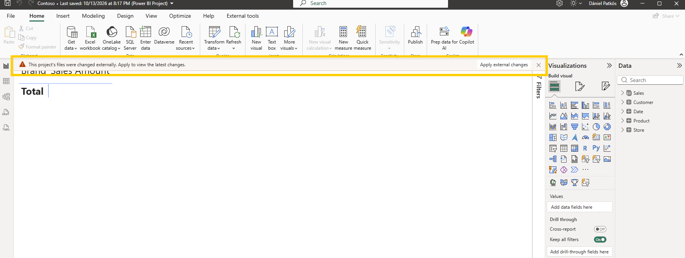

# powerbi-git-practice: hands-on git scenarios for Power BI teams

Seventeen scenarios that take a Power BI team from "we just switched to PBIP" to
promoting approved changes dev → UAT → prod with confidence. Each one is one
git task on real TMDL/PBIR files, with the VS Code way and the terminal way
shown side by side. Most take 10 to 20 minutes, and every one of them can check
your result: `python tools/check.py <id>`.

> Companion repo to the article *[title TBD]* on Fabricated Insights.

## How it works

There are two kinds of scenarios.

**Self-guided (most of them).** You start from `main`, prepare the starting
point yourself (where needed you play both Anna and Ben), and follow the
steps. Each file ends with a short "How to know it worked" checklist. No
workflows needed: when you're done, run the check on your own machine (see
below).

**With an automatic check: s04, s05, s12 and s15.**

1. **Make your own copy.** Click **Use this template → Create a new repository**
   (public or private, your account). Everything runs in *your* copy.
2. **Start the scenario.** In your copy: **Actions → Start scenario → Run workflow**,
   pick the scenario. This creates its starting branches. Re-run it any time
   to start over.

   
3. **Do the steps** in the scenario file.
4. **Push.** The **Check submission** workflow checks your branch and puts a ✅
   or ❌ next to your commit on GitHub; click it to see what passed. Push a fix
   and it checks again.

Only the end result is checked (files and, where it's the lesson, the shape of
the history), so any correct approach passes.

**Check on your own machine.** Every scenario has a local check. In the VS Code
terminal, from the repo folder:

```bash
python tools/check.py s06
```

It looks at your local branches and prints what passed and what's still
missing. For s04, s05, s12 and s15 it runs the same checks as the workflow, so
you can check before you push.

## A note on terminal vs. VS Code UI

For all git operations in these scenarios (creating branches, staging,
committing, merging) you can use either the **VS Code Source Control panel** or
the **integrated terminal**. Both are shown throughout.

> Tip: The VS Code UI is a great way to see exactly what changed before you
> commit. The terminal is faster once you're comfortable with the commands, and
> a few things (cherry-pick with `-x`, squash, reverting a merge) only work
> there. Use whichever feels right for you.

## Before you start

- Git 2.30+ and a GitHub account. VS Code or any editor is enough; Power BI
  Desktop is optional for most scenarios.
- Python 3.9+ for `tools/check.py`. No packages needed.
- **Keep the repo in a short path**, like `C:\dev\powerbi-git-practice`, not deep
  inside OneDrive. PBIR paths are long, and Windows stops at 260 characters: git
  then shows report files as changed (`Filename too long`), and Desktop can't
  detect external changes. Also run `git config --global core.longpaths true`
  once.
- Optional: the [Git Graph](https://marketplace.visualstudio.com/items?itemName=mhutchie.git-graph)
  extension for VS Code. A few VS Code UI steps (like revert in s15) use it.
- New to PBIP and git? My [step-by-step setup guide](https://www.visuallabs.com/lab/articles/my-journey-with-ci-cd-in-power-bi-a-personal-tale-of-transformation-part-3) covers installing git
  and VS Code, connecting to a repo and saving your first PBIP.
- **Apply the changes in Power BI Desktop after every switch.** When git changes
  the project files (switch, merge, reset, restore), Desktop shows a banner with
  `Apply external changes`. Click it before you do anything else in Desktop: if you
  save first, Desktop writes the old version back over the files you just
  checked out. This needs the August 2026 release or later, and it's still a
  preview feature: turn on `Detect and reload external PBIP changes` under
  `File` > `Options and settings` > `Options` > `Preview features`, then restart
  Desktop. On an older version, close Desktop before you switch and reopen it
  after.

  

## Using Azure DevOps?

The scenarios are plain git, and `tools/check.py` runs anywhere, so everything
works in an Azure DevOps repo too. Only the two GitHub Actions workflows don't.
What's different:

- **Getting the repo:** `Repos` > `Import repository`, paste the GitHub URL. All
  branches come along, including the `module/...` ones.
- **No Start scenario button.** For s04, s05, s12 and s15, build the starting
  branches yourself: `NO_PUSH=1 bash tools/setup/s04.sh` (Git Bash on Windows).
  Then follow the steps and check with `python tools/check.py s04`.
- **Pull requests (s08)** live under `Repos` > `Pull requests`. The tip at the
  end of s08 shows what's different.

## The demo project and its data

`Contoso.pbip` is a small Contoso sales model (6 tables, 5 measures, 3 report
pages). The data comes from SQLBI's
[Contoso Data Generator V2](https://github.com/sql-bi/Contoso-Data-Generator-V2-Data)
(10k orders, MIT license).

The data is **not** in the repo. It's attached to the
[`data-v1` release](../../releases/tag/data-v1) as CSV files, and Power Query
downloads them from there when you refresh. The base URL is the `DataUrl`
parameter (Transform data -> Manage parameters), so you can point it somewhere
else if you need to.

The only change to SQLBI's files: `customer.csv` is trimmed to the 1,663
customers who appear in `sales.csv`.

The git scenarios only touch the TMDL and PBIR files, so you don't need to
refresh to do them. Refresh when you want to see the numbers.

## Scenarios

| # | Scenario | Module | Time · level | Type |
|---|---|---|---|---|
| s01 | [Start using PBIP, set up the repo, first commits](scenarios/0-setup/s01-pbip-and-repo-setup.md) | 0 · Setup | 20 min · beginner | 📘 self-guided |
| s02 | [Create a feature branch](scenarios/1-basics/s02-feature-branch.md) | 1 · Solo basics | 10 min · beginner | 📘 self-guided |
| s03 | [Merge back to another branch](scenarios/1-basics/s03-merge-back.md) | 1 · Solo basics | 15 min · beginner | 📘 self-guided |
| s04 | [Same file, same measure: what git merges and what you decide](scenarios/2-conflicts/s04-measure-conflict.md) | 2 · Parallel work & conflicts | 20 min · beginner | ✅ automatic check |
| s05 | [Report conflict: which page was open?](scenarios/2-conflicts/s05-pbir-page-conflict.md) | 2 · Parallel work & conflicts | 20 min · intermediate | ✅ automatic check |
| s06 | [Delete vs edit](scenarios/2-conflicts/s06-delete-vs-edit.md) | 2 · Parallel work & conflicts | 20 min · intermediate | 📘 self-guided |
| s07 | [Silent conflict: rename vs reference](scenarios/2-conflicts/s07-silent-rename.md) | 2 · Parallel work & conflicts | 20 min · intermediate | 📘 self-guided |
| s08 | [Create a PR with a review checklist](scenarios/3-collaboration/s08-pull-request.md) | 3 · Collaboration | 20 min · beginner | 📘 self-guided |
| s09 | [Squash vs regular merge](scenarios/3-collaboration/s09-squash.md) | 3 · Collaboration | 15 min · intermediate | 📘 self-guided |
| s10 | [Rebase (and why not to force-push shared branches)](scenarios/3-collaboration/s10-rebase.md) | 3 · Collaboration | 20 min · intermediate | 📘 self-guided |
| s11 | [Update your branch with a merge (the alternative to rebase)](scenarios/3-collaboration/s11-update-with-merge.md) | 3 · Collaboration | 15 min · intermediate | 📘 self-guided |
| s12 | [Cherry-pick to promote (+ optional: a half-approved commit)](scenarios/4-promotion/s12-cherry-pick.md) | 4 · Promotion | 15 min (+20 optional) · intermediate | ✅ automatic check |
| s13 | [Hotfix + backport to dev](scenarios/4-promotion/s13-hotfix-backport.md) | 4 · Promotion | 20 min · intermediate | 📘 self-guided |
| s14 | [Tag what you deploy to PROD](scenarios/4-promotion/s14-tag-prod.md) | 4 · Promotion | 20 min · intermediate | 📘 self-guided |
| s15 | [Revert a commit](scenarios/5-recovery/s15-revert-commit.md) | 5 · Recovery | 10 min · beginner | ✅ automatic check |
| s16 | [Revert a merge commit](scenarios/5-recovery/s16-revert-merge.md) | 5 · Recovery | 20 min · advanced | 📘 self-guided |
| s17 | [Undo local commits with reset (and get them back with reflog)](scenarios/5-recovery/s17-reset.md) | 5 · Recovery | 20 min · intermediate | 📘 self-guided |

## Branch model

| Branch | Purpose |
|---|---|
| `main` | Baseline model, scenario docs, tooling. The grader always runs from here. |
| `module/<n>-<name>` | Starting point for a module's scenarios. |
| `sNN/...` | A scenario's sandbox, created and reset by **Start scenario**. `sNN/shared` (or `dev`/`uat`/`prod`) plays the team branch. |

## Repo layout

```
Contoso.pbip               the demo project: open this in Power BI Desktop
Contoso.SemanticModel/     the model as TMDL
Contoso.Report/            the report as PBIR
scenarios/<module>/<id>.md one file per scenario: why, task, what's checked, solution
tools/check.py             check any scenario on your own machine
tools/scenarios.json       scenario registry: ids, time, level, graded branches, status
tools/setup/sNN.sh         builds a scenario's starting branches
tools/checks/sNN.py        the checks, used by check.py and the GitHub workflow
tools/tmdl.py              minimal TMDL read/edit helper (stdlib only)
.github/workflows/         start-scenario.yml, check-submission.yml
docs/maintainer.md         how to add a scenario, local testing, design notes
```

## License

TBD
