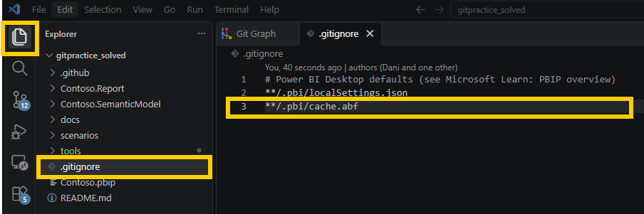

# s01 · Start using PBIP, set up repo and your first commits

Module 0: Setup · self-guided: you prepare the starting point yourself, no automatic check

## Why this matters

Before anyone commits anything, the repo needs a `.gitignore`. It keeps `cache.abf` and `localSettings.json` out, and Power BI Desktop creates it for you.

Why is it important? The `.gitignore` makes sure that certain files won't be pushed to the repo. The cache, for example, stores the actual data of your PBI project if you are using import mode. And data should not be in your repo, because of:

- data security (I don't think your InfoSec team would be happy if they found out someone uploaded next year's forecast into a repo)
- repo size: a repo is for code, not for huge files. Recently we took over a project where, for some reason, the cache was not part of the `.gitignore`. That meant a 10+ GB repo, and it took hours to sync it the first time.

The second half is about commits. You don't have to commit everything you changed. Git lets you choose exactly what goes into each commit, and throw away the rest, which comes in handy when you were trying things out in Desktop.


> Tip: Starting from zero with your own report? Save it as PBIP first: `File` > `Save as` > `Power BI Project (.pbip)`, then open that folder in VS Code and click `Initialize Repository` in the Source Control panel.

> Tip: New to the whole setup? I wrote a step-by-step guide on installing git and VS Code, connecting to a repo and saving your first PBIP: [My Journey with CI/CD in Power BI, Part 3](https://www.visuallabs.com/lab/articles/my-journey-with-ci-cd-in-power-bi-a-personal-tale-of-transformation-part-3). It uses Azure DevOps, but the local setup is the same with GitHub.


## Start

Starting point: your copy of the repo, on a practice branch from `main`.


## Steps

**One-time setup** (skip it if you've done it before)

1. Tell git who you are. Open VS Code, open a terminal (`` Ctrl+` ``) and run:
   ```bash
   git config --global user.name "Your Name"
   git config --global user.email "your.email@example.com"
   ```
   Every commit you make carries this name, that's how `git log` and `git blame` know who did what.
2. Clone your copy of the repo:

   **VS Code UI:** `Ctrl+Shift+P` > `Git: Clone`, paste the URL of your repo, pick a folder and click `Open` when VS Code asks.

   **Terminal:**
   ```bash
   git clone https://github.com/YOUR-USERNAME/powerbi-git-practice.git
   cd powerbi-git-practice
   code .
   ```

   > Tip: Clone into a short path, like `C:\dev`, not deep inside OneDrive or Documents. The report files have long paths, and once the full path goes over 260 characters, Windows can't read them: git shows them as changed with `Filename too long`. Running `git config --global core.longpaths true` once helps git, but a short path is still the safest.
3. Create a practice branch, so `main` stays clean for the other scenarios:

   **VS Code UI:** Click the branch name in the bottom-left status bar, select `Create new branch from...`, pick `main` and type `s01/practice`.

   **Terminal:**
   ```bash
   git switch -c s01/practice main
   ```

**Part 1: see what the `.gitignore` does**

4. Open `.gitignore`. Find these two lines:
   ```
   **/.pbi/localSettings.json
   **/.pbi/cache.abf
   ```
   

   Put a `#` in front of both (that turns them into comments) and save.
5. Open `Contoso.pbip` in Power BI Desktop and save it right away: `Ctrl+S`.
6. Look at the Source Control panel in VS Code: `cache.abf` and `localSettings.json` show up as new files. That's what would land in the repo without the `.gitignore`.
7. Remove the two `#` again and save `.gitignore`. The two files disappear from the Source Control panel, and `.gitignore` itself shows no change any more.

**Part 2: add a measure and commit it**

8. In Power BI Desktop, select the `Sales` table and click `New measure`.
9. Enter the following DAX expression:
   ```dax
   Avg Age = AVERAGE ( Customer[Age] )
   ```
10. Save: `Ctrl+S`.
11. In the Source Control panel, click `Sales.tmdl` to see the diff. Only the new measure shows up.
12. Stage and commit:

    **VS Code UI:** Stage the changed file with `+`, enter the message `Added Avg Age measure`, and click `Commit`.

    **Terminal:**
    ```bash
    git add .
    git commit -m "Added Avg Age measure"
    ```

**Part 3: make several changes, commit only some**

13. In Power BI Desktop, select the `Sales` table, click `New measure` and enter:
    ```dax
    Double Margin = [Margin] * 2
    ```
14. Go to the `Demo` page, select the table visual, open the `Format` pane, go to `General` > `Effects` > `Background`, turn it on and pick a color.
15. Save: `Ctrl+S`.
16. In the Source Control panel you'll see changes in both the report files and `Sales.tmdl`. Stage only the report files, **not** `Sales.tmdl`:

    **VS Code UI:** Click `+` next to each report file, skip `Sales.tmdl`. Enter the message `Background color for the Demo table` and click `Commit`.

    **Terminal:**
    ```bash
    git add Contoso.Report/
    git commit -m "Background color for the Demo table"
    ```
17. Discard the `Double Margin` change, which is still there as an unstaged change:

    **VS Code UI:** Under `Changes`, right-click `Sales.tmdl` and select `Discard Changes`.

    **Terminal:**
    ```bash
    git restore Contoso.SemanticModel/definition/tables/Sales.tmdl
    ```
18. Back in Desktop, click `Apply external changes` in the banner. `Avg Age` is there, `Double Margin` is gone: it was never committed, so discarding brought the file back to its last committed state.

> Tip: When git changes the files under an open Desktop (discard, switch, merge, reset), always click `Apply external changes` before anything else. If you save first, Desktop writes its old version back over the files. The banner needs the August 2026 release or later with the `Detect and reload external PBIP changes` preview feature turned on (`File` > `Options and settings` > `Options` > `Preview features`). Without it, close Desktop before the git step and reopen it after.
>
> 

## How to know it worked

- [ ] `cache.abf` and `localSettings.json` never show up in the Source Control panel
- [ ] `git log --oneline -3` shows `Added Avg Age measure` and `Background color for the Demo table`
- [ ] `Avg Age` is in the `Sales` table, `Double Margin` isn't
- [ ] The background color commit changed only report files (click it in the Source Control Graph)
- [ ] `python tools/check.py s01` says all good (it checks the result for you)
