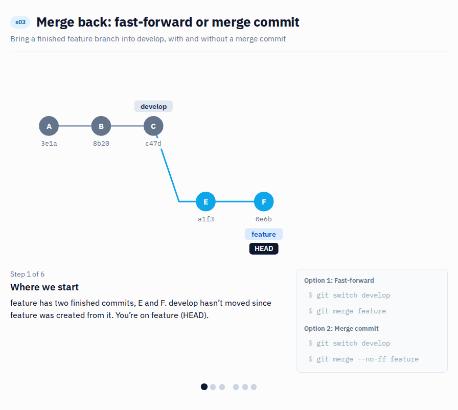

# s03 · Merge back to another branch

Module 1: Solo basics · self-guided: you prepare the starting point yourself, no automatic check

## Why this matters



Finished work goes to an in-between branch first (develop, for example), not straight to the final one.

Why? Because "finished" on your laptop doesn't mean tested. The in-between branch is where changes from different people meet for the first time, and where you find out if they work together. In this scenario you do the merge locally, so you can see what git actually does.

> Note: Where "back" is depends on your team's branching strategy. Some teams use a `develop` branch like here. Others merge feature branches straight into `main` through a pull request with checks (often called trunk-based development). Others keep one branch per environment, like `dev`, `test` and `prod`, each connected to its own Fabric workspace. The git part is the same in every case: you merge a finished branch into the next one. Just make sure everyone on the team knows which branch is the "next one".

## What it looks like

`s03/feature-order-measures` has two finished commits. `s03/develop` hasn't moved since the branch was created. Merging gives you two possible histories.

**Fast-forward** (`git merge --ff-only`): git just moves `develop` forward. It looks as if the work happened on `develop` directly:

```
* 92e8586 Add Average Price
* c6e3aaf Add Order Count
* 4c33612 Baseline model
```

**Merge commit** (`git merge --no-ff`): the feature stays visible as a side branch, with a merge commit on top:

```
*   c3750ec Merge branch 's03/feature-order-measures' into s03/develop
|\
| * 92e8586 Add Average Price
| * c6e3aaf Add Order Count
|/
* 4c33612 Baseline model
```

Both are fine. The second one has a practical advantage: the whole feature is one merge commit, so you can undo it in one step later (that's s16).

## Start

Starting point: `main`. You prepare a develop branch and a finished feature branch yourself.

## Steps

**Prepare**

1. Create `s03/develop` from `main`, then `s03/feature-order-measures` from `s03/develop`:

   **VS Code UI:** Click the branch name, `Create new branch from...`, pick `main`, type `s03/develop`. Then again: `Create new branch from...`, pick `s03/develop`, type `s03/feature-order-measures`.

   **Terminal:**
   ```bash
   git switch -c s03/develop main
   git switch -c s03/feature-order-measures
   ```
2. In Power BI Desktop, add a measure to `Sales`:
   ```dax
   Order Count = DISTINCTCOUNT ( Sales[Order Number] )
   ```
   Save, then stage and commit with the message `Add Order Count`.
3. Add a second one:
   ```dax
   Average Price = DIVIDE ( [Sales Amount], [Total Quantity] )
   ```
   Save, then stage and commit with the message `Add Average Price`.

**Merge it back**

4. Switch to `s03/develop`:

   **VS Code UI:** Click the branch name in the status bar and select `s03/develop`.

   **Terminal:**
   ```bash
   git switch s03/develop
   ```
5. Merge the feature branch into it:

   **VS Code UI:** In the Source Control panel open the `...` menu, select `Branch` > `Merge Branch...` and choose `s03/feature-order-measures`.

   **Terminal:**
   ```bash
   git merge s03/feature-order-measures
   ```
6. Look at the history: `View` > `Source Control Graph` in VS Code, or `git log --graph --oneline -5`. Git did a fast-forward: `develop` simply moved forward.
7. In Desktop, click `Apply external changes`: `Order Count` and `Average Price` are there.
8. Optional: undo the merge with `git reset --hard HEAD~2` (only OK because you haven't pushed), merge again with `git merge --no-ff s03/feature-order-measures`, and compare the two graphs.

## How to know it worked

- [ ] Both commits from the feature branch are on `s03/develop`
- [ ] The graph looks like the one under "What it looks like"
- [ ] `python tools/check.py s03` says all good (it checks the result for you)
