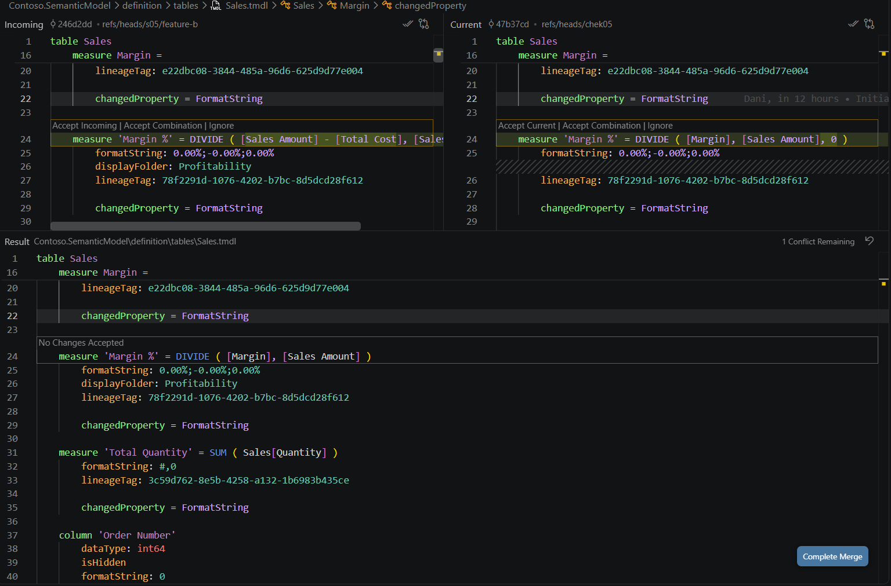
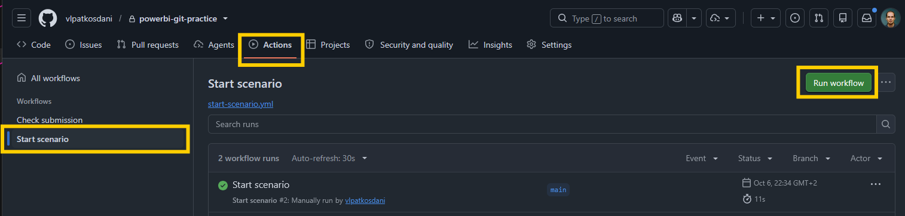
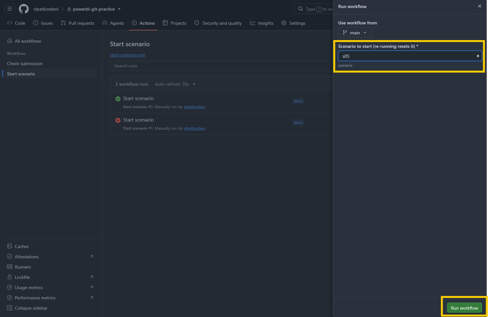

# s04 · Same file, same measure: what git merges and what you decide

Module 2: Parallel work & conflicts · automatic check when you push `s04/shared`

## Why this matters

Anna and Ben work on the semantic model at the same time, in the same `Sales.tmdl` file. Both change `Margin %` on their own branch. Anna wants it to show 0 instead of blank, Ben calculates it inline and moves it to a new display folder.

When we started using git, most of us expected a conflict every time two people touched the same file. With .pbix files that was the rule: one of them had to redo their work. Git doesn't compare whole files, it compares them line by line. Ben's display folder is on its own line, so git merges it without asking. Only the expression line, which both of them changed, is a real conflict.

So this scenario shows both sides: what git solves on its own, and what you have to decide. In real life the second part is usually a conversation with the other developer, not a git command.

## What it looks like

Both start from the same version:

```
measure 'Margin %' = DIVIDE ( [Margin], [Sales Amount] )
    formatString: 0.00%;-0.00%;0.00%
    lineageTag: 78f2291d-1076-4202-b7bc-8d5dcd28f612
```

**Anna** wants it to show 0 instead of blank when there are no sales. One line changes:

```diff
- measure 'Margin %' = DIVIDE ( [Margin], [Sales Amount] )
+ measure 'Margin %' = DIVIDE ( [Margin], [Sales Amount], 0 )
      formatString: 0.00%;-0.00%;0.00%
```

**Ben** calculates it inline and moves it to a new display folder. Two lines change:

```diff
- measure 'Margin %' = DIVIDE ( [Margin], [Sales Amount] )
+ measure 'Margin %' = DIVIDE ( [Sales Amount] - [Total Cost], [Sales Amount] )
      formatString: 0.00%;-0.00%;0.00%
+     displayFolder: Profitability
      lineageTag: 78f2291d-1076-4202-b7bc-8d5dcd28f612
```

Anna's branch is merged into `s04/shared` first, without any problem. When you then merge Ben's branch, git stops with a conflict, and `Sales.tmdl` looks like this:

```
<<<<<<< HEAD
measure 'Margin %' = DIVIDE ( [Margin], [Sales Amount], 0 )
=======
measure 'Margin %' = DIVIDE ( [Sales Amount] - [Total Cost], [Sales Amount] )
>>>>>>> origin/s04/feature-b
    formatString: 0.00%;-0.00%;0.00%
    displayFolder: Profitability
    lineageTag: 78f2291d-1076-4202-b7bc-8d5dcd28f612
```

How to read it:

- Between `<<<<<<< HEAD` and `=======` is the **current** version: what's already on `s04/shared`, so Anna's line.
- Between `=======` and `>>>>>>>` is the **incoming** version: Ben's line from the branch you're merging.
- Everything outside the markers is already merged. Look at `displayFolder: Profitability`: only Ben touched that line, so git kept it without asking.

The team agreed on Anna's expression plus Ben's folder. In VS Code that's one click on **Accept Current Change**: it keeps Anna's line, and the folder stays because it was never part of the conflict:

```
measure 'Margin %' = DIVIDE ( [Margin], [Sales Amount], 0 )
    formatString: 0.00%;-0.00%;0.00%
    displayFolder: Profitability
    lineageTag: 78f2291d-1076-4202-b7bc-8d5dcd28f612
```


*TMDL is indented with tabs in the real files; it's shown with spaces here. Commit hashes and lineageTags will be different on your machine.*

## Start

1. On GitHub, open your copy of the repo, go to `Actions` > `Start scenario` > `Run workflow`, pick `s04` and click `Run workflow`. Re-run it any time to start over.

   

   
2. Get the new branches:

   **VS Code UI:** In the Source Control panel open the `...` menu and select `Fetch`.

   **Terminal:**
   ```bash
   git fetch origin
   ```

Starting state: `s04/shared`, `s04/feature-a` (Anna's `Margin %`) and `s04/feature-b` (Ben's `Margin %`). Both branches start from the same commit.

## Steps

1. Switch to `s04/shared`:

   **VS Code UI:** Click the branch name in the status bar and select `origin/s04/shared`.

   **Terminal:**
   ```bash
   git switch s04/shared
   ```
2. Merge Anna's branch. This one goes through without a conflict:

   **VS Code UI:** `...` > `Branch` > `Merge Branch...` > `origin/s04/feature-a`.

   **Terminal:**
   ```bash
   git merge origin/s04/feature-a
   ```
3. Now merge Ben's branch (`origin/s04/feature-b`) the same way. Git reports a conflict in `Sales.tmdl`.
4. Open `Sales.tmdl` in VS Code. You'll see the two versions of the `Margin %` line highlighted, and the `displayFolder` line already merged below them.
5. The team agreed: keep Anna's expression (`0` instead of blank) and Ben's display folder. Click **Accept Current Change**. Anna's line stays, and the folder stays too, because it was never part of the conflict.
6. Save the file.
7. Stage and commit the resolved file:

   **VS Code UI:** Stage `Sales.tmdl` in the Source Control panel and click `Commit` (VS Code pre-fills the merge commit message).

   **Terminal:**
   ```bash
   git add .
   git commit
   ```
8. Open `Contoso.pbip` in Power BI Desktop and check `Margin %`: Anna's DAX, in the `Profitability` folder.
9. Push:

   **VS Code UI:** Click `Sync Changes`.

   **Terminal:**
   ```bash
   git push
   ```

## How it's checked

When you push, the **Check submission** workflow checks your branch. You'll see ✅ or ❌ next to your latest commit on GitHub; click it for the details. Push a fix and it checks again.

- No conflict markers left
- Both Anna's and Ben's branches are merged into `s04/shared`
- `Margin %` = `DIVIDE ( [Margin], [Sales Amount], 0 )`, in the `Profitability` folder, format unchanged
- The other measures are untouched

Want to know before you push? Run `python tools/check.py s04` in the terminal. It runs the same checks on your local branch.

## Tips

> Tip: Try the wrong answers too, then re-run Start scenario: **Accept Incoming Change** gives Ben's DAX, and `git checkout --ours Sales.tmdl` takes Anna's whole file, which loses the folder. The check catches both.

> Tip: A merge conflict doesn't mean something broke. Git found two different versions of the same line and needs you to decide.
