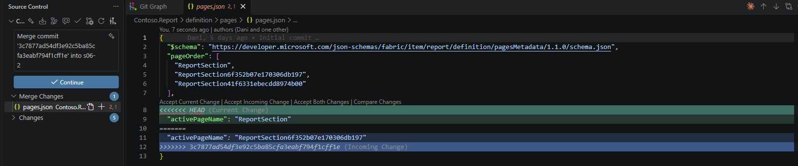

# s05 · Report conflict: which page was open?

Module 2: Parallel work & conflicts · automatic check when you push `s05/shared`

## Why this matters

PBIR conflicts feel different from TMDL ones. The report is stored as JSON, so the conflict is in the middle of brackets and commas. After you fix it, the file still has to be valid JSON, otherwise Power BI Desktop won't open the report.

And the first report conflict most teams hit isn't a real change at all: it's which page was open when someone saved.

## What it looks like

`pages.json` is a small file that lists the report pages and remembers which one was open when you saved:

```
{
  "pageOrder": [
    "ReportSection",
    "ReportSection6f352b07e170306db197",
    "ReportSection41f6331ebecdd8974b00"
  ],
  "activePageName": "ReportSection41f6331ebecdd8974b00"
}
```

The names are page ids, not the names you see in Desktop. `ReportSection` is **Page 1**, `ReportSection6f352b07e170306db197` is **Page 2**, and `ReportSection41f6331ebecdd8974b00` is **Demo** (each page's `page.json` has its `displayName`).

On one branch you save with Page 1 open, on the other with Page 2 open. The first merge goes through, the second one stops:

```
$ git merge s05/page-2
Auto-merging Contoso.Report/definition/pages/pages.json
CONFLICT (content): Merge conflict in Contoso.Report/definition/pages/pages.json
Automatic merge failed; fix conflicts and then commit the result.
```

```
  "pageOrder": [
    "ReportSection",
    "ReportSection6f352b07e170306db197",
    "ReportSection41f6331ebecdd8974b00"
  ],
<<<<<<< HEAD
  "activePageName": "ReportSection"
=======
  "activePageName": "ReportSection6f352b07e170306db197"
>>>>>>> s05/page-2
}
```

Nobody changed anything on purpose here: you just had a different page open when you saved. That's the point of this exercise. A merge conflict doesn't mean something broke, it means git found two different values for the same line and needs you to pick one.

The only real risk with JSON: if you resolve it by hand and leave a comma or a bracket behind, Desktop can't open the report.

## Start

1. On GitHub, open your copy of the repo, go to `Actions` > `Start scenario` > `Run workflow`, pick `s05` and click `Run workflow`. Re-run it any time to start over.
2. Get the new branches:

   **VS Code UI:** In the Source Control panel open the `...` menu and select `Fetch`.

   **Terminal:**
   ```bash
   git fetch origin
   ```

Starting state: `s05/shared` with the baseline report (saved with the Demo page open). You create the two conflicting branches yourself.

## Steps

**First branch: Page 1**

1. Create a branch `s05/page-1` from `s05/shared`:

   **VS Code UI:** Click the branch name in the status bar, select `Create new branch from...`, pick `origin/s05/shared` and type `s05/page-1`.

   **Terminal:**
   ```bash
   git switch -c s05/page-1 origin/s05/shared
   ```
2. Open `Contoso.pbip` in Power BI Desktop and click on **Page 1**.
3. Save: `Ctrl+S`.
4. Stage and commit:

   **VS Code UI:** Stage the changed file, enter the message `switched to Page 1`, click `Commit`.

   **Terminal:**
   ```bash
   git add .
   git commit -m "switched to Page 1"
   ```

**Second branch: Page 2**

5. Create a branch `s05/page-2`, also from `origin/s05/shared` (same as step 1).
6. In Desktop, click `Apply external changes`, then click on **Page 2** and save.
7. Stage and commit with the message `switched to Page 2`.

**Merge both into `s05/shared`**

8. Switch to `s05/shared` and merge `s05/page-1`. No conflict:

   **VS Code UI:** Click the branch name, select `origin/s05/shared`. Then `...` > `Branch` > `Merge Branch...` > `s05/page-1`.

   **Terminal:**
   ```bash
   git switch s05/shared
   git merge s05/page-1
   ```
9. Merge `s05/page-2` the same way. Git reports a conflict in `pages.json`.
10. Open `pages.json` in VS Code and pick one:
    - **Accept Current Change**: the report opens on Page 1
    - **Accept Incoming Change**: the report opens on Page 2
    - **Manual**: type whichever page ID you want and delete the conflict markers

    
11. Save the file, then stage and commit it:

    **VS Code UI:** Stage `pages.json` and click `Commit`.

    **Terminal:**
    ```bash
    git add .
    git commit
    ```
12. In Desktop, click `Apply external changes` and check that it opens on the page you chose.
13. Push `s05/shared`:

    **VS Code UI:** Click `Sync Changes`.

    **Terminal:**
    ```bash
    git push
    ```

## How it's checked

When you push, the **Check submission** workflow checks your branch. You'll see ✅ or ❌ next to your latest commit on GitHub; click it for the details. Push a fix and it checks again.

- `pages.json` and all `visual.json` files are valid JSON
- No conflict markers
- Both of your branches are merged into `s05/shared`

Want to know before you push? Run `python tools/check.py s05` in the terminal. It runs the same checks on your local branch.

## Tips

> Tip: If Desktop changed more than `pages.json` when you saved (it sometimes rewrites a visual), you may get more than one conflict. Same approach for each file.
