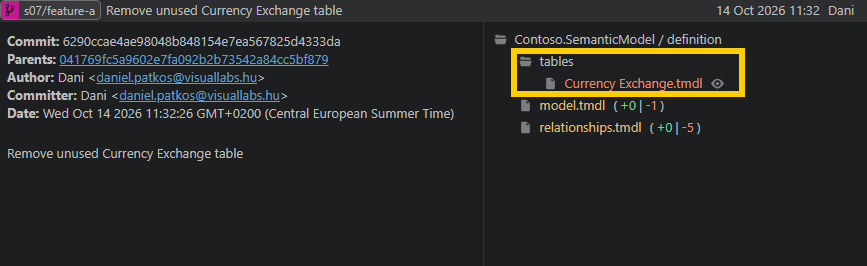
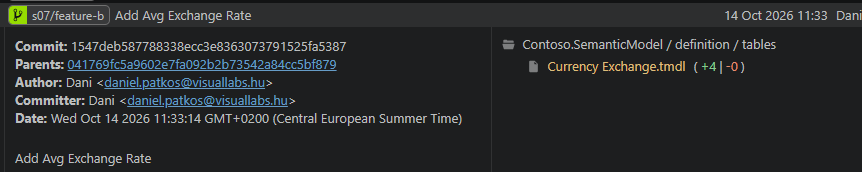
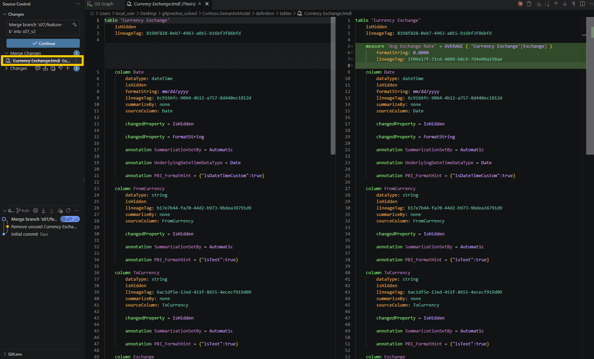
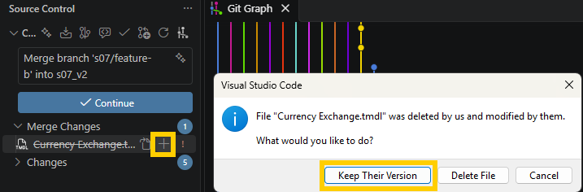

# s06 · Delete vs edit

Module 2: Parallel work & conflicts · self-guided: you prepare the starting point yourself and check it locally with `python tools/check.py s06` (no GitHub check)

## Why this matters

Anna is cleaning up the model and deletes the `Currency Exchange` table, because she thinks nobody uses it. At the same time Ben adds a new measure to that same table on his own branch. Both changes are fine on their own branch. The trouble starts when you merge them.

This conflict is different from the one in s04. There, two people changed the same line, and git put conflict markers in the file. Here one side deleted the whole file and the other side changed it, so there's nothing to compare line by line. Git can't tell if the table should stay or go, so it stops the merge and you have to decide. You won't see any markers, only a `DU` line in `git status`, so you need to know how to read it.

In a real team this is rarely a git question. Someone has to find out if the table is still needed (does a report or a measure use it?), and then you resolve the merge to match that answer. If you just pick whichever side comes first, a table can disappear, or one that was deleted on purpose comes back, and nobody notices until a report breaks.

One more thing to watch out for: when Desktop deletes a table, it also removes the `ref` line from `model.tmdl` and the table's relationship from `relationships.tmdl`. Those changes merge without a conflict, so if you decide to keep the table, you have to bring them back yourself.

## What it looks like

Anna deletes the `Currency Exchange` table. Desktop removes it from three places:

```
 Contoso.SemanticModel/definition/model.tmdl        |  1 -
 .../definition/relationships.tmdl                  |  5 --
 .../definition/tables/Currency Exchange.tmdl       | 75 ----------------------
 3 files changed, 81 deletions(-)
```

Meanwhile Ben adds `Avg Exchange Rate` to that table. Anna's branch is merged into `s06/shared` first. Then Ben's:

```
$ git merge s06/feature-b
CONFLICT (modify/delete): Contoso.SemanticModel/definition/tables/Currency Exchange.tmdl deleted in HEAD and modified in s06/feature-b.  Version s06/feature-b of Contoso.SemanticModel/definition/tables/Currency Exchange.tmdl left in tree.
Automatic merge failed; fix conflicts and then commit the result.

$ git status --short
DU "Contoso.SemanticModel/definition/tables/Currency Exchange.tmdl"
```

`DU` means "deleted by us, updated by them". That's the only question git asks. But Anna's delete also removed these two, and git doesn't mention them, because Ben never touched those lines:

```diff
 ref table Store
-ref table 'Currency Exchange'
```

```diff
-relationship a7c057d3-ede2-4fdd-812a-d5be2dc1569f
-    fromColumn: 'Currency Exchange'.Date
-    toColumn: Date.Date
```

If you only keep the table file, you get a table that's no longer referenced in `model.tmdl` and has lost its relationship to `Date`. To keep the table properly, take all three files from Ben's branch:

```
$ git checkout s06/feature-b -- "Contoso.SemanticModel/definition/tables/Currency Exchange.tmdl" Contoso.SemanticModel/definition/model.tmdl Contoso.SemanticModel/definition/relationships.tmdl
$ git status --short
M  Contoso.SemanticModel/definition/model.tmdl
M  Contoso.SemanticModel/definition/relationships.tmdl
A  "Contoso.SemanticModel/definition/tables/Currency Exchange.tmdl"
$ git commit --no-edit
```

## Start

Starting point: `main`. You play both Anna and Ben.

## Steps

**Prepare**

1. Create `s06/shared` from `main`, then `s06/feature-a` from it:
   ```bash
   git switch -c s06/shared main
   git switch -c s06/feature-a
   ```
2. As Anna: in Power BI Desktop, right-click the `Currency Exchange` table and select `Delete from model`. It's a hidden table: find it in the Model view, or turn on `View hidden` in the Data pane (`...` menu). Save. Commit with the message `Remove unused Currency Exchange table`. Look at the commit: three files changed, not one.

   
3. Create `s06/feature-b` from `s06/shared`:
   ```bash
   git switch -c s06/feature-b s06/shared
   ```
4. As Ben: in Desktop, click `Apply external changes` first, so the table is back. Then add a measure to the `Currency Exchange` table (hidden again, use the Model view or `View hidden`), save and commit with the message `Add Avg Exchange Rate`:
   ```dax
   Avg Exchange Rate = AVERAGE ( 'Currency Exchange'[Exchange] )
   ```

   

**Merge both**

5. Switch to `s06/shared` and merge Anna's branch. No conflict:

   **VS Code UI:** Click the branch name, select `s06/shared`. Then `...` > `Branch` > `Merge Branch...` > `s06/feature-a`.

   **Terminal:**
   ```bash
   git switch s06/shared
   git merge s06/feature-a
   ```
6. Merge Ben's branch (`s06/feature-b`). Git stops: one side deleted `Currency Exchange.tmdl`, the other changed it. Click the file under `Merge Changes` to see Ben's version next to the version before his change:

   
7. The team decides to **keep** the table, because a report still uses it. Take all three files from Ben's branch: the table, the `ref` in `model.tmdl` and the relationship. Git only asks about the first one; the other two were already removed by Anna's merge.

   **VS Code UI** (for the table file only): click `+` next to `Currency Exchange.tmdl` under `Merge Changes` and select `Keep Their Version`. That brings back the table, but not the `ref` and the relationship, so run the terminal command below anyway.

   

   **Terminal** (all three files at once, VS Code has no button for taking a file from another branch):
   ```bash
   git checkout s06/feature-b -- "Contoso.SemanticModel/definition/tables/Currency Exchange.tmdl" Contoso.SemanticModel/definition/model.tmdl Contoso.SemanticModel/definition/relationships.tmdl
   ```
8. Commit:

   **VS Code UI:** The three files are staged already. Click `Continue` (during a merge the `Commit` button is labelled `Continue`).

   **Terminal** (`--no-edit` keeps git's default merge message, so no editor opens):
   ```bash
   git commit --no-edit
   ```
9. In Desktop, click `Apply external changes`. Check that `Currency Exchange` is there, has `Avg Exchange Rate`, and is still related to `Date` (Model view).

## How to know it worked

- [ ] `Currency Exchange` is in the model with `Avg Exchange Rate`
- [ ] Its relationship to `Date` is there
- [ ] `model.tmdl` has the `ref table 'Currency Exchange'` line again
- [ ] Optional: re-do it keeping only the table file, and see what's missing in the Model view
- [ ] `python tools/check.py s06` says all good (it checks the result for you)

## Tips

> Tip: `git status` tells you who deleted and who changed: `DU` = deleted by us, updated by them.
