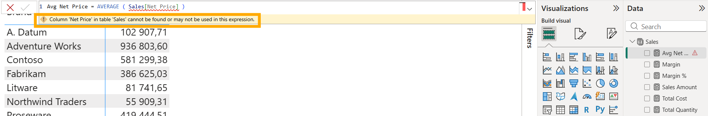

# s07 · Silent conflict: rename vs reference

Module 2: Parallel work & conflicts · self-guided: you prepare the starting point yourself and check it locally with `python tools/check.py s07` (no GitHub check)

## Why this matters

Anna renames the `Net Price` column to `Net Unit Price` and updates `Sales Amount`. Ben adds a new measure, `Avg Net Price`, that still uses `Sales[Net Price]`.

Git merges both branches without a single warning, because the changes are in different places. Git only compares text, it doesn't know DAX. The result is a broken model on the shared branch. This is why a green merge button is not enough, and why it's worth running BPA or other checks in the pipeline after a merge.

## What it looks like

Anna renames the column. In TMDL that's two lines: the column itself and the measure that uses it.

```diff
-    measure 'Sales Amount' = SUMX ( Sales, Sales[Quantity] * Sales[Net Price] )
+    measure 'Sales Amount' = SUMX ( Sales, Sales[Quantity] * Sales[Net Unit Price] )
...
-    column 'Net Price'
+    column 'Net Unit Price'
```

Ben, on his own branch, adds a measure using the old name:

```diff
+    measure 'Avg Net Price' = AVERAGE ( Sales[Net Price] )
+        formatString: #,0.00
```

Both get merged. Git doesn't complain at all:

```
$ git merge --no-edit s07/ben
Auto-merging Contoso.SemanticModel/definition/tables/Sales.tmdl
Merge made by the 'ort' strategy.
 Contoso.SemanticModel/definition/tables/Sales.tmdl | 4 ++++
 1 file changed, 4 insertions(+)
```

But `Avg Net Price` now points to a column that doesn't exist. Desktop shows an error on the measure, and your report may fail or display the "grey visual" if the measure is used in a visual.



To find it, search for the old name **in brackets**, the way DAX references it:

```
$ git grep -n "\[Net Price\]" -- "*.tmdl"
Contoso.SemanticModel/definition/tables/Sales.tmdl:36:    measure 'Avg Net Price' = AVERAGE ( Sales[Net Price] )
```

Without the brackets you'd also get `sourceColumn: Net Price` and the Power Query steps. Those are fine: they're the name of the column in the CSV file, which didn't change.

*TMDL is indented with tabs in the real files; it's shown with spaces here. Commit hashes and lineageTags will be different on your machine.*

## Start

Starting point: `main`. You play both Anna and Ben.

## Steps

**Prepare**

1. Create `s07/shared` from `main`, then `s07/anna` from it:
   ```bash
   git switch -c s07/shared main
   git switch -c s07/anna
   ```
2. As Anna: in Power BI Desktop, rename the `Net Price` column in `Sales` to `Net Unit Price` (double-click it in the Data pane; it's a hidden column, so turn on `View hidden` in the Data pane's `...` menu, or use the Model view). Desktop updates `Sales Amount` for you. Save, commit with the message `Rename Net Price to Net Unit Price`.
3. Create `s07/ben` from `s07/shared`:
   ```bash
   git switch -c s07/ben s07/shared
   ```
4. As Ben: in Desktop, click `Apply external changes` first, so the column has its old name again. Then add a measure to `Sales` with format `#,0.00`, save, commit with the message `Add Avg Net Price`:
   ```dax
   Avg Net Price = AVERAGE ( Sales[Net Price] )
   ```

**Merge both, then find the problem**

5. Switch to `s07/shared` and merge `s07/anna`, then `s07/ben`:

   **VS Code UI:** Click the branch name, select `s07/shared`. Then `...` > `Branch` > `Merge Branch...`, once for each branch.

   **Terminal:**
   ```bash
   git switch s07/shared
   git merge s07/anna
   git merge --no-edit s07/ben
   ```
   No conflict, no warning. (`--no-edit` keeps git's default merge message, so no editor opens.)
6. In Desktop, click `Apply external changes`. One measure in `Sales` shows an error. Which one, and why?
7. Find every place that still uses the old column name:

   **VS Code UI:** `Ctrl+Shift+F`, search for `[Net Price]`, with files to include: `*.tmdl` (otherwise you also get hits in the scenario `.md` files).

   **Terminal:**
   ```bash
   git grep -n "\[Net Price\]" -- "*.tmdl"
   ```
8. Fix `Avg Net Price` in Desktop:
   ```dax
   Avg Net Price = AVERAGE ( Sales[Net Unit Price] )
   ```
9. Save and commit with the message `Fix Avg Net Price after column rename`.

## How to know it worked

- [ ] Desktop shows no error on any measure
- [ ] `git grep -n "\[Net Price\]" -- "*.tmdl"` finds nothing
- [ ] `python tools/check.py s07` says all good (it checks the result for you)
