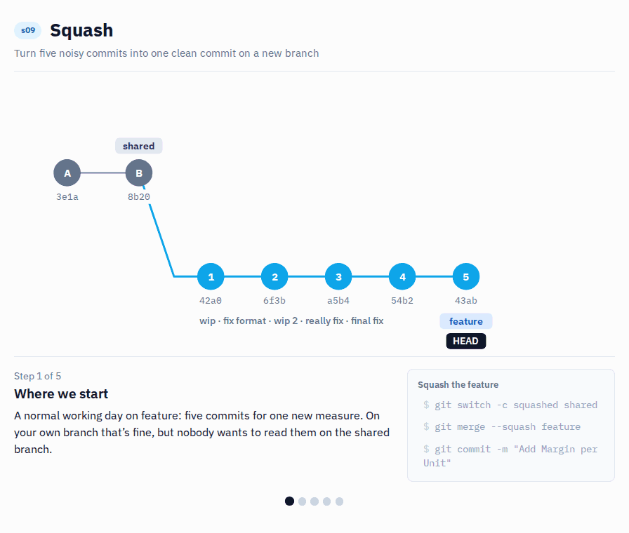

# s09 · Squash vs regular merge

Module 3: Collaboration · self-guided: you prepare the starting point yourself and check it locally with `python tools/check.py s09` (no GitHub check)

## Why this matters



"wip", "fix", "really fix", "final fix"... we all have these commits. Just as earlier we had "v3_final.pbix", "v3_final_FINAL.pbix" and "v3_1_USE_THIS.pbix".

On your own branch that's fine. But on the shared branch nobody wants to read through 15 commits to understand one change. Squashing turns them into one commit with a clear message. It also helps later: one commit is much easier to cherry-pick (s12) or revert (s15) than 15.

## What it looks like

What the feature branch looks like after a normal working day:

```
$ git log --oneline s09/shared..s09/feature
43abe4e final fix
54b2067 really fix
a5b457e wip 2
6f3b3bd fix format
42a0139 wip
```

Five commits, and the end result is one new measure (`Margin per Unit`). Squash them:

```
$ git switch -c s09/squashed s09/shared
$ git merge --squash s09/feature
Updating 4c33612..43abe4e
Fast-forward
Squash commit -- not updating HEAD
 ...
$ git commit -m "Add Margin per Unit"

$ git log --oneline -2
751cc38 Add Margin per Unit
4c33612 Baseline model
```

Don't let `Fast-forward` fool you: `Squash commit -- not updating HEAD` means nothing is committed yet. The changes are only staged, the `git commit` makes the one commit. (Hashes and the commit below yours will be different on your machine.)

Same result, one commit. You can prove it: comparing the two branches shows no difference at all.

```
$ git diff s09/feature s09/squashed
$
```

Compare that with a regular merge (`git merge --no-ff s09/feature`): the shared branch would get all five commits, "wip" to "final fix", plus a merge commit on top.

## Start

Starting point: `main`. You make the noisy commits yourself.

## Steps

**Prepare: a normal working day**

1. Create `s09/shared` from `main`, then `s09/feature` from it:
   ```bash
   git switch -c s09/shared main
   git switch -c s09/feature
   ```
2. Make five small commits in Power BI Desktop, saving and committing after each one:
   - add `Margin Amount = [Sales Amount] - [Total Cost]`, commit `wip`
   - change its format to 2 decimals, commit `fix format`
   - add `Margin per Unit = DIVIDE ( [Margin Amount], [Total Quantity] )`, commit `wip 2`
   - change `Margin per Unit` to `DIVIDE ( [Margin], [Total Quantity] )`, commit `really fix`
   - delete `Margin Amount`, commit `final fix`
3. Look at the history (`View` > `Source Control Graph`, or `git log --oneline s09/shared..`). Five commits for one new measure.

**Squash**

4. Create `s09/squashed` from `s09/shared`:
   ```bash
   git switch -c s09/squashed s09/shared
   ```
5. Bring all changes of the feature branch over as **one** commit. Terminal only, VS Code has no squash button:
   ```bash
   git merge --squash s09/feature
   git commit -m "Add Margin per Unit"
   ```
   The merge prints `Squash commit -- not updating HEAD`: it only stages the changes, so don't skip the `git commit`.

   

6. Check that nothing is lost: there's no difference between the two branches.
   ```bash
   git diff s09/feature s09/squashed
   ```

## How to know it worked

- [ ] `git log --oneline s09/shared..s09/squashed` shows exactly one commit
- [ ] `git diff s09/feature s09/squashed` shows nothing
- [ ] `Margin per Unit` is `DIVIDE ( [Margin], [Total Quantity] )` and `Margin Amount` is gone
- [ ] `python tools/check.py s09` says all good (it checks the result for you)

## Tips

> Tip: When you merge with a pull request on GitHub, the `Squash and merge` button does the same thing.

> Tip: In this scenario we squashed all the commits of the branch into one. In real life that's not always what you want. Feel free to experiment with squashing only some of them, for example the last three of the feature branch. Do it on a copy, so `s09/feature` stays as it is for the check: `git switch -c s09/try s09/feature`, then `git reset --soft HEAD~3` and commit again.
