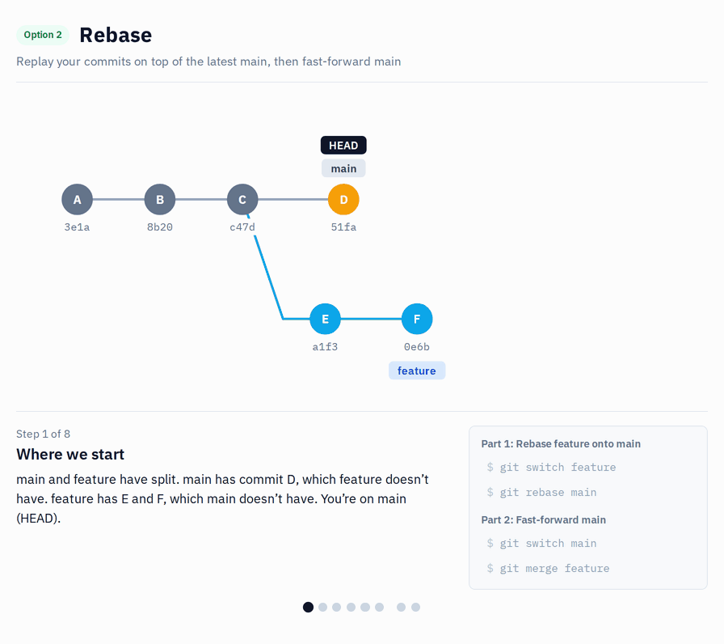
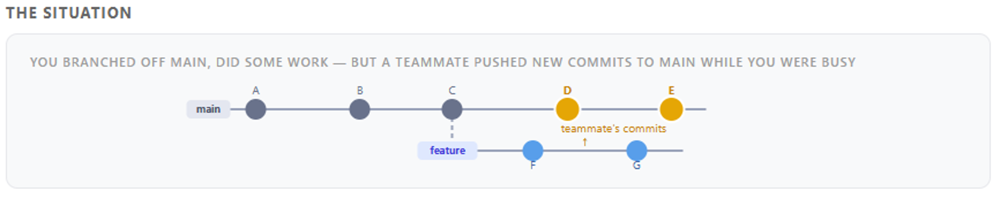

# s10 · Rebase (and why not to force-push shared branches)

Module 3: Collaboration · self-guided: you prepare the starting point yourself and check it locally with `python tools/check.py s10` (no GitHub check)

## Why this matters



One of the first questions I get when I explain working with git and Power BI: how does it work when several people work on the same model at the same time? You are halfway through a feature, and in the meantime someone else finishes another feature or a hotfix and merges it into the shared branch. Now the shared branch has changes that your branch doesn't have. It is "ahead" of yours.



In the picture you created your feature branch from commit C and made F and G on it. Meanwhile your teammate added D and E to main. Your branch still starts from C, it knows nothing about D and E. Before your work goes to main, you want D and E on your branch too: that way you can test your changes together with theirs in Power BI Desktop, and if there's a conflict, you fix it on your branch, not on main.

There are two ways to do that. This scenario shows rebase, [s11](s11-update-with-merge.md) does the same with a merge.

Rebase takes your commits (F and G) off the branch, moves the starting point of your branch from C to E, then applies your commits again, one by one, on top of E. The result looks as if you had created your branch today, after your teammate's work: A, B, C, D, E, F, G in one straight line.

The catch: the F and G you get after the rebase are new commits. They contain the same changes, but they have a different hash, because they now sit on a different parent. For git the old F and G are simply gone. If the branch only exists on your laptop, nobody notices. If you already pushed it, the server still has the old commits, so a normal push is rejected and you have to force-push. And if a colleague also works on that branch, their copy still has the old F and G. The next time they pull, git sees two versions of the same changes, and they end up with both in the history, often with conflicts on top.

So rebasing your own feature branch is fine, as often as you like. For branches others work on (dev, UAT, PROD) it's a team decision and teams do it differently: some never allow it, some allow it if everybody knows about it. Agree on the rule before somebody force-pushes.

## What it looks like

Before: your feature branch (`Add Order Count`) started from an older version of the shared branch. Ben added two commits since:

```
* d84e43a Sales Amount: Sales folder
* 79b6b14 Total Cost: no decimals
| * bee2089 Add Order Count
|/
* 4c33612 Baseline model
```

After `git rebase s10/shared`:

```
$ git rebase s10/shared
Successfully rebased and updated refs/heads/s10/feature.

* 9211a26 Add Order Count
* d84e43a Sales Amount: Sales folder
* 79b6b14 Total Cost: no decimals
* 4c33612 Baseline model
```

*Commit hashes (and the `Baseline model` commit at the bottom) will be different on your machine.*

One straight line. But look at the hash: `bee2089` became `9211a26`. Rebase doesn't move your commit, it creates a new one. If you pushed the branch before, the server still has `bee2089`, so a normal push is rejected and the push needs force:

```
$ git push
 ! [rejected]        s10/feature -> s10/feature (non-fast-forward)
...
$ git push --force-with-lease
 + bee2089...9211a26 s10/feature -> s10/feature (forced update)
```

On your own branch that's fine. On a shared branch, everyone who pulled `bee2089` now has a commit that no longer exists on the server.

### In short

Replay your commits on top of the latest shared branch, then fast-forward the shared branch.

**Part 1: Rebase your feature branch onto shared**
```bash
git switch s10/feature
git rebase s10/shared
git push --force-with-lease
```

**Part 2: Fast-forward shared**
```bash
git switch s10/shared
git merge s10/feature
```

## Start

Starting point: `main`. You play yourself and Ben.

## Steps

**Prepare**

1. Create `s10/shared` from `main`, then your feature branch from it:
   ```bash
   git switch -c s10/shared main
   git switch -c s10/feature
   ```
2. On your branch, add `Order Count = DISTINCTCOUNT ( Sales[Order Number] )`, save, commit `Add Order Count`.
3. Push your branch, so you can see later what a rebase does to a pushed branch:

   **VS Code UI:** `Publish Branch`.

   **Terminal:**
   ```bash
   git push -u origin s10/feature
   ```
4. Now play Ben. Switch to `s10/shared`:
   ```bash
   git switch s10/shared
   ```
   In Desktop, click `Apply external changes`, then make two commits there: `Total Cost` to 0 decimals (`Total Cost: no decimals`), and `Sales Amount` into a `Sales` display folder (`Sales Amount: Sales folder`).
5. Look at the graph (`View` > `Source Control Graph`, or `git log --graph --oneline -6 s10/shared s10/feature`). Your branch and `s10/shared` have split. Write down the hash of `Add Order Count`.

**Rebase**

6. Switch back to your branch:
   ```bash
   git switch s10/feature
   ```
7. Rebase it onto the latest `s10/shared`:

   **VS Code UI:** `Ctrl+Shift+P` > `Git: Rebase Branch...` > `s10/shared`.

   **Terminal:**
   ```bash
   git rebase s10/shared
   ```
8. Look at the graph again (`git log --graph --oneline -6 s10/shared s10/feature`): one straight line, and your commit has a new hash.
9. Try a normal push first. It's rejected, because the server still has your old commit:
   ```bash
   git push
   ```
   ```
    ! [rejected]        s10/feature -> s10/feature (non-fast-forward)
   ...
   hint: ... use 'git pull' before pushing again.
   ```
   **Don't follow that hint.** After a rebase, `git pull` would merge your old commit back in, and you'd have `Add Order Count` twice in the history. The same goes for VS Code's `Sync Changes` button, it pulls too. Force the push instead, safely:
   ```bash
   git push --force-with-lease
   ```
   (VS Code hides force push behind the `git.allowForcePush` setting, so use the terminal here.)

**Bring it back to shared**

10. Merge your branch into `s10/shared`. Git does a fast-forward, because after the rebase your branch already has everything from shared on top:
    ```bash
    git switch s10/shared
    git merge s10/feature
    ```

## How to know it worked

- [ ] One straight line in the graph, your commit on top
- [ ] `Order Count` and both of Ben's changes are in the model
- [ ] Your commit's hash is different from before the rebase
- [ ] The normal `git push` was rejected, `git push --force-with-lease` worked
- [ ] Merging back into `s10/shared` was a fast-forward
- [ ] `python tools/check.py s10` says all good (it checks the result for you)

## Tips

> Tip: `--force-with-lease` refuses to overwrite the branch if someone else pushed to it in the meantime. Plain `--force` doesn't check.

> Tip: Don't rebase a branch others work on (shared, dev, UAT, PROD) unless the team has agreed on it.

> Tip: Want to compare? [s11](s11-update-with-merge.md) solves the same situation with a merge, no force-push needed.
