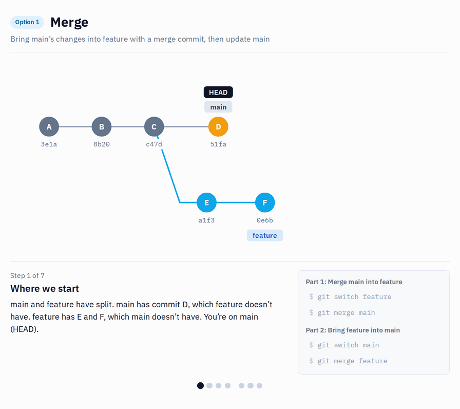

# s11 · Update your branch with a merge (the alternative to rebase)

Module 3: Collaboration · self-guided: you prepare the starting point yourself and check it locally with `python tools/check.py s11` (no GitHub check)

## Why this matters



Same situation as in [s10](s10-rebase.md): you are working on your feature branch, and in the meantime a teammate merged their work into the shared branch. The shared branch is ahead of yours, and you want their changes on your branch before your work goes back.


In s10 you solved it with a rebase. This time you merge the shared branch into your feature branch. It's the same merge you already know from s03 and s04, just in the other direction: not feature into shared, but shared into feature.

Git takes Ben's new commits from the shared branch and combines them with your own commit in a new commit, the merge commit. Your own commits stay exactly as they were, with the same hashes. Nothing is rewritten, so a normal push works, and if a colleague also works on your branch, they can simply pull.

The price is the history. It's not one straight line any more: you see the split and the merge commit (`Merge branch 's11/shared' into s11/feature`). If you update your branch every day, you get a merge commit every day. Some people find that noisy, others like that the history shows what really happened.

Which one to use is again a team decision. If you are not sure, merge is the safer choice: it never needs a force-push, and you can't lose commits by accident. A lot of Power BI teams only use merge for exactly this reason.

## What it looks like

Before: exactly like s10. Your feature branch (`Add Order Count`) started from an older version of the shared branch. Ben added two commits since:

```
* d84e43a Sales Amount: Sales folder
* 79b6b14 Total Cost: no decimals
| * bee2089 Add Order Count
|/
* 4c33612 Baseline model
```

Merge the shared branch into your feature branch:

```
$ git switch s11/feature
$ git merge --no-edit s11/shared
Auto-merging Contoso.SemanticModel/definition/tables/Sales.tmdl
Merge made by the 'ort' strategy.
 Contoso.SemanticModel/definition/tables/Sales.tmdl | 3 ++-
 1 file changed, 2 insertions(+), 1 deletion(-)

*   e10779e Merge branch 's11/shared' into s11/feature
|\
| * d84e43a Sales Amount: Sales folder
| * 79b6b14 Total Cost: no decimals
* | bee2089 Add Order Count
|/
* 4c33612 Baseline model
```

Compare it with s10: your commit is still `bee2089`, nothing got a new hash. There's one extra commit, the merge itself. A normal `git push` is enough.

When your feature is ready and you merge it back into the shared branch, git has nothing left to combine, because your branch already contains everything from shared. It just moves the shared branch forward (fast-forward):

```
$ git switch s11/shared
$ git merge s11/feature
Updating d84e43a..e10779e
Fast-forward
 Contoso.SemanticModel/definition/tables/Sales.tmdl | 4 ++++
 1 file changed, 4 insertions(+)
```

*Commit hashes (and the `Baseline model` commit at the bottom) will be different on your machine, and the line counts can differ a bit depending on how you set up the measures.*

### In short

Bring the shared branch's changes into your feature branch with a merge commit, then update the shared branch.

**Part 1: Merge shared into your feature branch**
```bash
git switch s11/feature
git merge --no-edit s11/shared
git push
```

**Part 2: Bring your feature branch into shared**
```bash
git switch s11/shared
git merge s11/feature
```

## Start

Starting point: `main`. You play yourself and Ben, the same way as in s10.

## Steps

**Prepare**

1. Create `s11/shared` from `main`, then your feature branch from it:
   ```bash
   git switch -c s11/shared main
   git switch -c s11/feature
   ```
2. On your branch, add `Order Count = DISTINCTCOUNT ( Sales[Order Number] )`, save, commit `Add Order Count`.
3. Push your branch, so you can see later that a normal push is enough:

   **VS Code UI:** `Publish Branch`.

   **Terminal:**
   ```bash
   git push -u origin s11/feature
   ```
4. Now play Ben. Switch to `s11/shared`:
   ```bash
   git switch s11/shared
   ```
   In Desktop, click `Apply external changes`, then make two commits there: `Total Cost` to 0 decimals (`Total Cost: no decimals`), and `Sales Amount` into a `Sales` display folder (`Sales Amount: Sales folder`).
5. Look at the graph (`View` > `Source Control Graph`, or `git log --graph --oneline -6 s11/shared s11/feature`). Your branch and `s11/shared` have split. Write down the hash of `Add Order Count`.

**Merge shared into your branch**

6. Switch back to your branch:
   ```bash
   git switch s11/feature
   ```
7. Merge `s11/shared` into it:

   **VS Code UI:** In the Source Control panel open the `...` menu, select `Branch` > `Merge Branch...` and choose `s11/shared`.

   **Terminal:**
   ```bash
   git merge --no-edit s11/shared
   ```
   `--no-edit` keeps git's default message (`Merge branch 's11/shared' into s11/feature`), so no editor opens. If you forget it and you end up in Vim, type `:wq` and press Enter.
8. Look at the graph again (`git log --graph --oneline -6 s11/shared s11/feature`): the two lines join in a merge commit, and `Add Order Count` still has the same hash as in step 5.
9. In Desktop, click `Apply external changes` and check that `Order Count` and both of Ben's changes are there.
10. Push. No force needed (VS Code: `Sync Changes`):
    ```bash
    git push
    ```

**Bring it back to shared**

11. Merge your branch into `s11/shared`. Git does a fast-forward, because your branch already has everything from shared:
    ```bash
    git switch s11/shared
    git merge s11/feature
    ```

## How to know it worked

- [ ] The graph shows a merge commit on `s11/feature` with two parents (`s11/shared` merged into your branch, not the other way round)
- [ ] `Add Order Count` has the same hash as before the merge
- [ ] `git push` after the merge worked without `--force`, so GitHub has the same `s11/feature` as you
- [ ] `Order Count` and both of Ben's changes are in the model
- [ ] Merging back into `s11/shared` was a fast-forward
- [ ] `python tools/check.py s11` says all good (it checks the result for you)

## Tips

> Tip: In this scenario the merge has no conflict, because you and Ben changed different lines. If there is one, you resolve it just like in s04, once, in the merge commit. With a rebase you may have to resolve conflicts commit by commit.

> Tip: `git pull` does the same thing when someone pushed to *your* branch: it's a fetch plus a merge. If you want rebase there instead, that's `git pull --rebase`.

> Tip: Do the same exercise in s10 with rebase, then compare the two graphs side by side.
