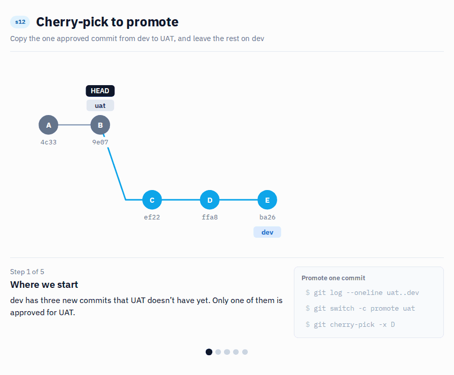
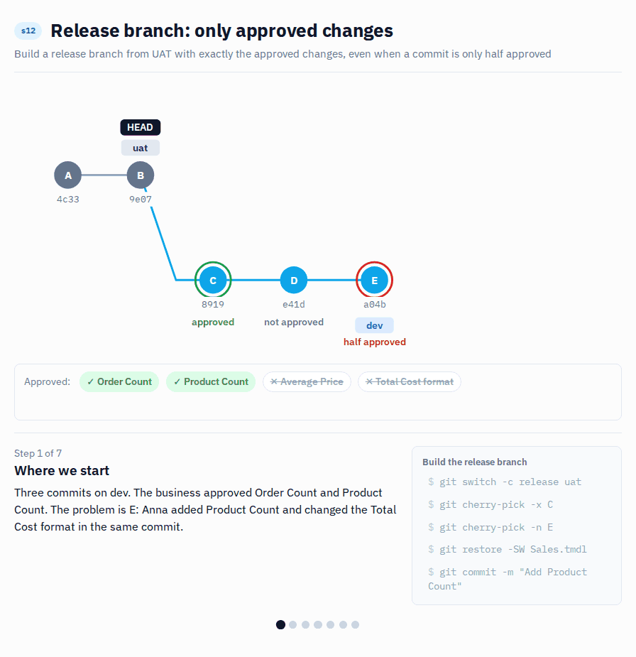

# s12 · Cherry-pick to promote

Module 4: Promotion · automatic check when you push `s12/promote`

## Why this matters



Dev has three new commits, and only one of them is approved for UAT.

This happens all the time. Several people work on dev at once, and their changes get finished and approved at different speeds. In this scenario the business has tested Ben's new `Average Price` measure and signed it off. `Order Count` is still waiting for feedback, and someone's experiment with `Sales Amount` shouldn't go anywhere yet. UAT is where the business tests, so it should only get what they agreed to look at.

If you merge dev into UAT, all three go, because a merge brings over everything on the branch, not only the commit you have in mind. Cherry-pick works differently: you point at one commit, and git copies the changes of that commit onto the branch you are on, as a new commit. The other two stay on dev and can follow later, once they are approved.

There's a price. The copy is a new commit with a new hash, so git doesn't know it's the same change as the one on dev. That's why we use `-x`: it writes the original hash into the commit message. And the more you cherry-pick, the harder it gets to follow which change is where, so it works best when one change is one commit. And when one commit holds an approved and an unapproved change at the same time, the optional part at the end shows how to split it.

## What it looks like

What's on dev but not on UAT:

```
$ git log --oneline origin/s12/uat..origin/s12/dev
ba26400 Sales Amount: use Unit Price (experiment)
ffa81d8 Add Average Price [APPROVED for UAT]
ef229f8 Add Order Count
```

Only the middle one is approved. Copy just that one:

```
$ git switch -c s12/promote --no-track origin/s12/uat
$ git cherry-pick -x ffa81d8
[s12/promote 6a61132] Add Average Price [APPROVED for UAT]
 Author: Ben Teammate <ben-teammate@example.com>
 ...
```

The new commit has a new hash (`6a61132`), but thanks to `-x` it remembers where it came from:

```
$ git log -1 --format=%B
Add Average Price [APPROVED for UAT]

(cherry picked from commit ffa81d882b57839966e0f234ae0fd248d4157958)
```

That line is your answer when someone asks "how did this get into UAT?" a month from now.

*Commit hashes will be different on your machine.*

## Start

1. On GitHub, open your copy of the repo, go to `Actions` > `Start scenario` > `Run workflow`, pick `s12` and click `Run workflow`. Re-run it any time to start over (see [Start over](#start-over)).
2. Get the new branches:

   **VS Code UI:** In the Source Control panel open the `...` menu and select `Fetch`.

   **Terminal:**
   ```bash
   git fetch origin
   ```

Starting state: `s12/uat` and `s12/dev`. Dev has 3 commits that UAT doesn't, and only `Add Average Price [APPROVED for UAT]` is approved.

## Steps

1. See what's on dev but not on UAT:

   **VS Code UI:** In the Source Control panel, look at the `Source Control Graph` section and compare `s12/dev` and `s12/uat`.

   **Terminal:**
   ```bash
   git log --oneline origin/s12/uat..origin/s12/dev
   ```
   Note the hash of the approved commit.
2. Create a branch `s12/promote` from UAT:

   **VS Code UI:** Click the branch name, `Create new branch from...`, pick `origin/s12/uat`, type `s12/promote`.

   **Terminal:**
   ```bash
   git switch -c s12/promote --no-track origin/s12/uat
   ```
   `--no-track` matters: without it your new branch would track `s12/uat`, and a plain `git push` (or git's own hint) would push straight into UAT.
3. Copy only the approved commit. Terminal, because the `-x` option isn't available in the VS Code UI:
   ```bash
   git cherry-pick -x <hash of the approved commit>
   ```
4. Open `Contoso.pbip` in Power BI Desktop: `Average Price` is there, `Order Count` isn't, and `Sales Amount` still uses `Net Price`.
5. Push:

   **VS Code UI:** Click `Publish Branch`. (If VS Code shows `Sync Changes` instead, the branch tracks `s12/uat`: use the terminal command below.)

   **Terminal:**
   ```bash
   git push -u origin s12/promote
   ```

## How it's checked

When you push, the **Check submission** workflow checks your branch. You'll see ✅ or ❌ next to your latest commit on GitHub; click it for the details. Push a fix and it checks again.

- Exactly one commit promoted
- `Average Price` is there with the right DAX and format
- `Order Count` and the `Sales Amount` experiment stayed on dev

Want to know before you push? Run `python tools/check.py s12` in the terminal. It runs the same checks on your local branch.

## Start over

1. Re-run `Start scenario` for `s12` on GitHub. It resets `s12/uat` and `s12/dev` and deletes `s12/promote` on GitHub, but not on your laptop.
2. Clean up your laptop:
   ```bash
   git switch main
   git fetch origin --prune
   git branch -D s12/promote
   ```
   (If you also want to redo the optional part, delete your local `s12/opt-...` branches the same way.)
3. Begin again at [Steps](#steps).

## Going further (optional): a commit that's only half approved



The real-life version of the above. Some changes are approved, some are not, and one commit contains both. A merge or a PR won't work here, and a simple cherry-pick brings too much. So you create a release branch from UAT and build it up with only the approved changes. It takes longer than a merge, but you know exactly what goes to UAT.

You prepare this part yourself, starting from `main`, on `s12/opt-...` branches. The automatic check of `s12/promote` doesn't look at them, but `python tools/check.py s12` does.

### What it looks like

Three commits on dev. The business approved `Order Count` and `Product Count`, nothing else:

```
$ git log --oneline s12/opt-uat..s12/opt-dev
a04bed1 Product Count + Total Cost format
e41db63 Add Average Price
89192e2 Add Order Count
```

The problem is `a04bed1`: Anna did two things in one commit.

```
$ git show --stat a04bed1
 Contoso.SemanticModel/definition/tables/Product.tmdl | 4 ++++
 Contoso.SemanticModel/definition/tables/Sales.tmdl   | 2 +-
```

`Product.tmdl` is the approved `Product Count`. The `Sales.tmdl` line is the `Total Cost` format change, which isn't approved. Build the release branch step by step:

```
$ git switch -c s12/opt-release s12/opt-uat
$ git cherry-pick -x 89192e2              # Order Count, approved as a whole
$ git cherry-pick -n a04bed1              # apply, but don't commit yet
$ git status --short
M  Contoso.SemanticModel/definition/tables/Product.tmdl
M  Contoso.SemanticModel/definition/tables/Sales.tmdl
$ git restore --staged --worktree Contoso.SemanticModel/definition/tables/Sales.tmdl
$ git status --short
M  Contoso.SemanticModel/definition/tables/Product.tmdl
$ git commit -m "Add Product Count (approved part of a04bed1)"
```

Result, exactly the approved set:

```
$ git log --oneline s12/opt-uat..s12/opt-release
b31c76d Add Product Count (approved part of a04bed1)
86333a1 Add Order Count
```

### Steps

**Prepare**

1. Create `s12/opt-uat` from `main`, then `s12/opt-dev` from it:
   ```bash
   git switch -c s12/opt-uat main
   git switch -c s12/opt-dev
   ```
2. Make three commits on dev in Power BI Desktop (save before each commit):
   - add `Order Count = DISTINCTCOUNT ( Sales[Order Number] )` to `Sales`, commit `Add Order Count`
   - add `Average Price = DIVIDE ( [Sales Amount], [Total Quantity] )` to `Sales`, commit `Add Average Price`
   - add `Product Count = COUNTROWS ( Product )` to `Product` **and** set `Total Cost` to 0 decimals, then commit both together as `Product Count + Total Cost format`
3. The business approved `Order Count` and `Product Count`. Nothing else.

**Build the release branch**

4. List the commits and look at the mixed one:
   ```bash
   git log --oneline s12/opt-uat..s12/opt-dev
   git show --stat <hash of "Product Count + Total Cost format">
   ```
5. Create `s12/opt-release` from UAT:
   ```bash
   git switch -c s12/opt-release s12/opt-uat
   ```
6. Bring over `Add Order Count`, it's approved as a whole:
   ```bash
   git cherry-pick -x <hash of "Add Order Count">
   ```
7. Bring over the mixed commit **without committing it** (`-n`):
   ```bash
   git cherry-pick -n <hash of "Product Count + Total Cost format">
   ```
8. Throw away the part that isn't approved, the `Total Cost` change in `Sales.tmdl`:

   **VS Code UI:** In the Source Control panel, right-click `Sales.tmdl` under `Staged Changes` and select `Unstage Changes`, then right-click it under `Changes` and select `Discard Changes`.

   **Terminal:**
   ```bash
   git restore --staged --worktree Contoso.SemanticModel/definition/tables/Sales.tmdl
   ```
9. Only `Product.tmdl` is left. Commit it with the message `Add Product Count (approved part of <hash>)`, using the hash of the mixed commit:

   **VS Code UI:** Type the message in the Source Control panel and click `Commit`.

   **Terminal:**
   ```bash
   git commit -m "Add Product Count (approved part of <hash>)"
   ```

### How to know it worked

- [ ] `git log --oneline s12/opt-uat..s12/opt-release` shows two commits
- [ ] On `s12/opt-release`: `Order Count` and `Product Count` are there, `Average Price` isn't, `Total Cost` still has 2 decimals
- [ ] Or run `python tools/check.py s12`: it checks `s12/promote` and, if it exists, `s12/opt-release` (so create `s12/promote` first, otherwise the optional part isn't checked)

## Tips

> Tip: `-x` adds `(cherry picked from commit ...)` to the message, so later you can see where the change came from.

> Tip: Squash your commits before you cherry-pick them (s09). One change in one commit means you only have to pick once, and the history stays easy to follow.

> Tip: If the unapproved change is in the same file as an approved one, use `git restore -p <file>`: it shows each change and asks which to keep.
