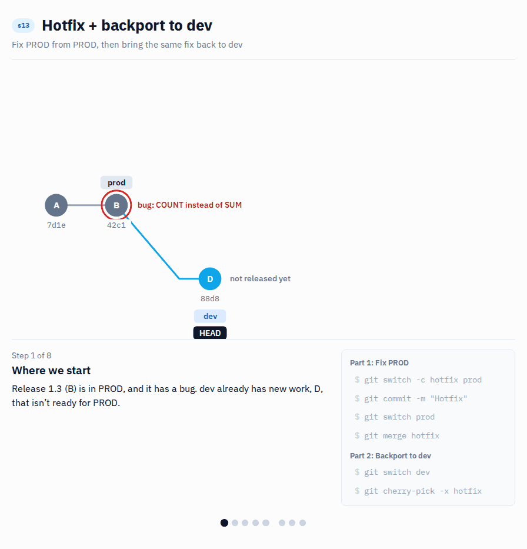

# s13 · Hotfix + backport to dev

Module 4: Promotion · self-guided: you prepare the starting point yourself, no automatic check

## Why this matters



There's a bug in PROD and it can't wait for the next release.

You can't fix it on dev, because dev already has other changes that aren't ready for PROD. So you create a hotfix branch from PROD, fix the bug there and release it. Then comes the part that's easy to forget: bring the same fix back to dev. Otherwise the next release goes out from dev without the fix, and the bug is back in PROD.

## What it looks like

PROD has a bug from release 1.3: `Total Quantity` counts rows instead of summing quantities. Dev already has new work that isn't released yet.

The fix starts from PROD, not from dev, so nothing unreleased goes along. Then the same fix is cherry-picked to dev. The end result:

```
* c64bf29 Hotfix: Total Quantity back to SUM            <- s13/prod
| * b0343ec Hotfix: Total Quantity back to SUM          <- s13/dev
| * 88d8a95 Add Order Count (not released yet)
|/
* 42c1c8a Release 1.3
```

The fix exists twice, with two different hashes, once on each line. That's expected. Skip the backport, and the next release from dev still has `COUNT ( Sales[Quantity] )` in it. The bug comes back, and this time nobody is looking for it.

## Start

Starting point: `main`. You prepare PROD (with a bug) and dev (with unreleased work) yourself.

## Steps

**Prepare**

1. Create `s13/prod` from `main`. Break `Total Quantity` in Desktop by changing it to `COUNT ( Sales[Quantity] )`, save, commit `Release 1.3`.
   ```bash
   git switch -c s13/prod main
   ```
2. Create `s13/dev` from `s13/prod` and add unreleased work: `Order Count = DISTINCTCOUNT ( Sales[Order Number] )`, commit `Add Order Count (not released yet)`.
   ```bash
   git switch -c s13/dev s13/prod
   ```

**Fix PROD**

3. Create `s13/hotfix` from PROD, not from dev:

   **VS Code UI:** Click the branch name, `Create new branch from...`, pick `s13/prod`, type `s13/hotfix`.

   **Terminal:**
   ```bash
   git switch -c s13/hotfix s13/prod
   ```
4. In Power BI Desktop, click `Apply external changes` first (`Order Count` disappears, it's only on dev). Then change `Total Quantity` back to:
   ```dax
   Total Quantity = SUM ( Sales[Quantity] )
   ```
5. Save, then stage and commit with the message `Hotfix: Total Quantity back to SUM`.
6. Merge the hotfix into PROD:
   ```bash
   git switch s13/prod
   git merge s13/hotfix
   ```

**Bring the fix back to dev**

7. Switch to dev and copy the fix:
   ```bash
   git switch s13/dev
   git cherry-pick -x s13/hotfix
   ```
8. Look at the graph (`git log --graph --oneline --all -6`): the fix is on both lines.

## How to know it worked

- [ ] `s13/prod`: `Total Quantity` is `SUM`, and there's no `Order Count`
- [ ] `s13/dev`: `Total Quantity` is `SUM`, and `Order Count` is still there
- [ ] `python tools/check.py s13` says all good (it checks the result for you)

## Tips

> Tip: In a real team, the hotfix goes into PROD through your normal release process (often a pull request). The point here is where the branch starts: PROD, not dev.
