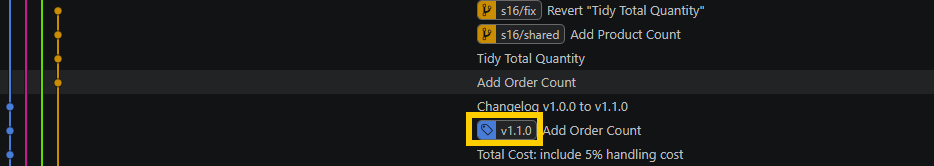

# s14 · Tag what you deploy to PROD

Module 4: Promotion · self-guided: you prepare the starting point yourself and check it locally with `python tools/check.py s14`

## Why this matters

Branches move, tags don't. A tag is a fixed label on the commit you deployed to PROD, and you only need it later, when someone asks a question about the past.

The typical one: in October the controller asks why Q3 margin in the board pack differs from what the report shows today. Without tags you dig through `git log` by date and guess which commit was in PROD that day. With a tag on every PROD deployment it's one command, and comparing two tags shows everything that changed in between. The tag is also your rollback target: you know exactly which version to go back to.

### Where tags help in a Power BI project

1. **"Which numbers did the board see?"** Tag every PROD deployment, and `git show <tag>:<path to Sales.tmdl>` shows the DAX exactly as it was in PROD that day. This is the strongest case, especially for finance reports.
2. **Release notes and change approval.** `git diff v1.3..v1.4 -- "*.tmdl"` lists every measure and column that changed since the last deployment. If your team needs sign-off (a change board or the business), the tag is the fixed reference for what was approved. A branch can move after the approval, a tag can't.
3. **Deploy and roll back by tag.** With code-based CI/CD (GitHub Actions or Azure DevOps, for example with fabric-cicd), the pipeline can deploy whenever a `v*` tag is pushed. PROD then always matches a tagged commit, and rolling back means re-running the deployment on the previous tag.
4. **Same model, several clients.** If one model template goes to several clients, tags tell you who has which version (client A on v2.1, client B on v2.3), and a hotfix for client A can start from `v2.1` instead of today's main.

### When tags don't add much

If PROD is a Fabric workspace synced straight from a branch, the workspace follows the branch, not the tag. The tag still tells you what to go back to, but you get there with a revert on the branch (s15, s16). And if nobody ever asks about the past, the branch history is enough.

## What it looks like

Two PROD deployments, both tagged:

```
$ git tag -n
data-v1         Initial commit
v1.0.0          PROD deployment 2026-07-01
v1.1.0          PROD deployment 2026-08-15
```

(`data-v1` comes with the repo: it's the release that holds the CSV data. Ignore it here.)

The controller asks why Q3 margin is lower than in the July board pack. First, what did `Margin` look like in July?

```
$ git show v1.0.0:Contoso.SemanticModel/definition/tables/Sales.tmdl
...
    measure Margin =
            [Sales Amount] - [Total Cost]
            // comment
        formatString: #,0.00
```

Exactly the same as today. So the question is what else changed between the two deployments:

```
$ git diff v1.0.0 v1.1.0 -- "*.tmdl"
-    measure 'Total Cost' = SUMX ( Sales, Sales[Quantity] * Sales[Unit Cost] )
+    measure 'Total Cost' = SUMX ( Sales, Sales[Quantity] * Sales[Unit Cost] ) * 1.05
...
+    measure 'Order Count' = DISTINCTCOUNT ( Sales[Order Number] )
```

There it is. `Total Cost` started including a 5% handling cost in v1.1.0, so `Margin` went down without anyone touching it. And in which commits:

```
$ git log --oneline v1.0.0..v1.1.0
45bdbfc Add Order Count
ac9a205 Total Cost: include 5% handling cost
```

Without tags, you'd be guessing which commit was in PROD on which day, and it's easy to get lost in the commit history looking for the right commit. With a tag it's right there in the graph:



*TMDL is indented with tabs in the real files; it's shown with spaces here. Commit hashes and lineageTags will be different on your machine, and your graph may show other branches.*

## Start

Starting point: `main`. You create two tagged PROD deployments yourself.

## Steps

**Prepare: two deployments**

1. Create `s14/prod` from `main` and tag it as the July deployment:
   ```bash
   git switch -c s14/prod main
   git tag -a v1.0.0 -m "PROD deployment 2026-07-01"
   ```
   You haven't committed anything yet, so `v1.0.0` sits on the same commit as `main`'s tip. That's fine: this is what was in PROD in July.
2. In Power BI Desktop, change `Total Cost` in the `Sales` table to include a 5% handling cost, save, commit `Total Cost: include 5% handling cost`:
   ```dax
   Total Cost = SUMX ( Sales, Sales[Quantity] * Sales[Unit Cost] ) * 1.05
   ```
   ```bash
   git add Contoso.SemanticModel/definition/tables/Sales.tmdl
   git commit -m "Total Cost: include 5% handling cost"
   ```
3. Add `Order Count = DISTINCTCOUNT ( Sales[Order Number] )` to the `Sales` table, save, commit `Add Order Count`:
   ```bash
   git add Contoso.SemanticModel/definition/tables/Sales.tmdl
   git commit -m "Add Order Count"
   ```
4. Tag the August deployment, on the `Add Order Count` commit (the one you're on now):

   **VS Code UI:** `Ctrl+Shift+P` > `Git: Create Tag`, name `v1.1.0`, message `PROD deployment 2026-08-15`.

   **Terminal:**
   ```bash
   git tag -a v1.1.0 -m "PROD deployment 2026-08-15"
   ```

**The controller's question: why is margin lower than in July?**

5. Look at `Margin` as it was in `v1.0.0`:
   ```bash
   git show v1.0.0:Contoso.SemanticModel/definition/tables/Sales.tmdl
   ```
   Same DAX as today.
6. List everything that changed in the model between the two deployments:
   ```bash
   git diff v1.0.0 v1.1.0 -- "*.tmdl"
   git log --oneline v1.0.0..v1.1.0
   ```
7. Write the answer into a new `CHANGELOG.md` (which measures changed between `v1.0.0` and `v1.1.0`, and why margin is lower) and commit it with the message `Changelog v1.0.0 to v1.1.0`:
   ```bash
   git add CHANGELOG.md
   git commit -m "Changelog v1.0.0 to v1.1.0"
   ```

## How to know it worked

- [ ] `git tag -n` lists `v1.0.0` and `v1.1.0` with their messages
- [ ] `git cat-file -t v1.0.0` prints `tag`, so it's an annotated tag (a lightweight tag prints `commit`; `git tag -n` can't tell them apart)
- [ ] Your changelog names `Total Cost` as the reason margin went down
- [ ] `python tools/check.py s14` says all good

## Tips

> Tip: You don't need a GitHub release for this, the tag alone is enough. To share tags, push them: `git push origin --tags`.

> Tip: To start over, delete the tags and your local branch, then begin again at step 1 (`git tag -a` refuses to reuse a tag name that already exists):
> ```bash
> git switch main
> git tag -d v1.0.0 v1.1.0
> git push origin --delete v1.0.0 v1.1.0   # only if you pushed the tags
> git branch -D s14/prod
> ```
