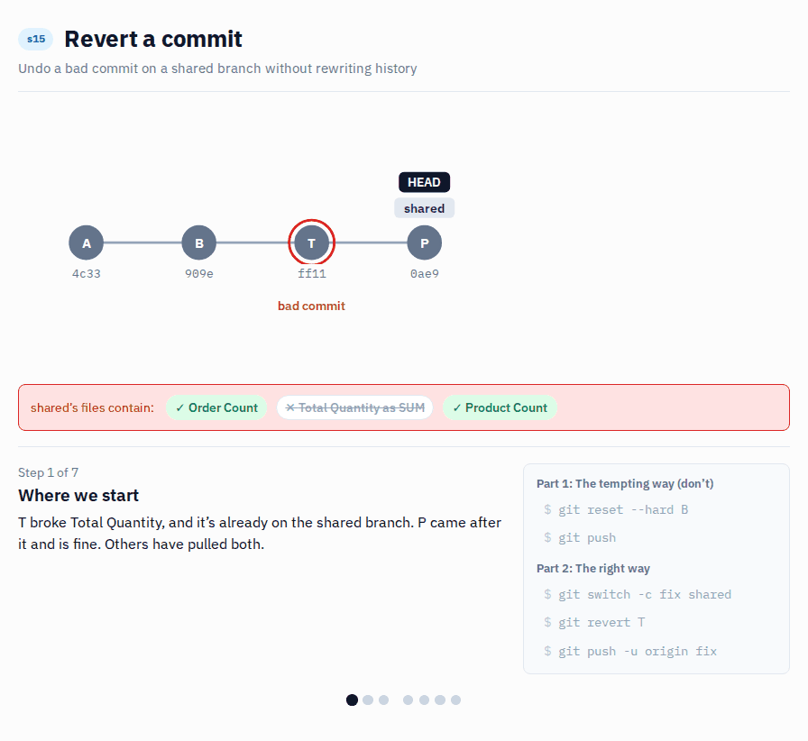
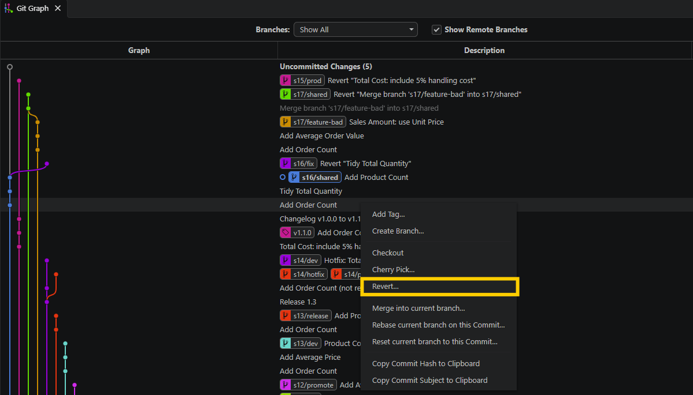

# s15 · Revert a commit

Module 5: Recovery · automatic check when you push `s15/fix`

## Why this matters



A bad commit is already on the shared branch, and others have pulled it.

The first idea is usually `git reset --hard`: go back one commit and pretend nothing happened. On your own branch that's fine. On a shared branch it rewrites the history, and everyone who already pulled the bad commit is out of sync. `git revert` creates a new commit that undoes the bad one, so everyone can just pull.

## What it looks like

The shared branch, with the bad commit in the middle:

```
$ git log --oneline -4 origin/s15/shared
0ae9a06 Add Product Count
ff11e3a Tidy Total Quantity
909e148 Add Order Count
4c33612 Baseline model
```

```diff
-    measure 'Total Quantity' = SUM ( Sales[Quantity] )
-        formatString: #,0
+    measure 'Total Quantity' = COUNT ( Sales[Quantity] )
+        formatString: 0.00
```

**The tempting way:** `git reset --hard` back before the bad commit. It also throws away `Add Product Count`, and the push is rejected, because the server has commits your branch no longer has:

```
$ git push
 ! [rejected]        s15/shared -> s15/shared (non-fast-forward)
error: failed to push some refs to 'origin'
```

(Force-pushing "fixes" that, and breaks everyone else's copy.)

**The right way:** `git revert` adds a new commit that does the opposite:

```
$ git revert ff11e3a
[s15/fix 73d5a88] Revert "Tidy Total Quantity"
 1 file changed, 2 insertions(+), 2 deletions(-)

$ git log --oneline -5
73d5a88 Revert "Tidy Total Quantity"
0ae9a06 Add Product Count
ff11e3a Tidy Total Quantity
909e148 Add Order Count
4c33612 Baseline model
```

Nothing disappears from history, both good commits stay, and everyone can just pull.

*TMDL is indented with tabs in the real files; it's shown with spaces here. Commit hashes and lineageTags will be different on your machine, and the commit below the three scenario commits may have a different name than `Baseline model`.*

## Start

1. On GitHub, open your copy of the repo, go to `Actions` > `Start scenario` > `Run workflow`, pick `s15` and click `Run workflow`. Re-run it any time to start over (see [Start over](#start-over)).
2. Get the new branches:

   **VS Code UI:** In the Source Control panel open the `...` menu and select `Fetch`.

   **Terminal:**
   ```bash
   git fetch origin
   ```

Starting state: `s15/shared` with 3 commits on top: `Add Order Count` (good), `Tidy Total Quantity` (bad: COUNT instead of SUM), `Add Product Count` (good).

## Steps

1. Create a branch `s15/fix` from `s15/shared`:

   **VS Code UI:** Click the branch name, `Create new branch from...`, pick `origin/s15/shared`, type `s15/fix`.

   **Terminal:**
   ```bash
   git switch -c s15/fix --no-track origin/s15/shared
   ```
   `--no-track` matters: without it your new branch would track `s15/shared`, and a plain `git push` (or git's own hint) would push straight into the shared branch.
2. Find the bad commit:

   **VS Code UI:** In the Source Control panel, look at the `Source Control Graph` section.

   **Terminal:**
   ```bash
   git log --oneline -5
   ```
3. Revert it. Not the last commit, the one in the middle:

   **VS Code UI:** This needs the optional Git Graph extension (see the README). Without it, use the terminal. In Git Graph, right-click `Tidy Total Quantity` and select `Revert...`.

   

   **Terminal:**
   ```bash
   git revert <hash of "Tidy Total Quantity">
   ```
   Git opens a commit message editor. The default message (`Revert "Tidy Total Quantity"`) is fine: save and close it.
4. Check the history: the bad commit is still there, with a new revert commit on top.
   ```bash
   git log --oneline -5
   ```
5. Open `Contoso.pbip` in Power BI Desktop: `Total Quantity` is back to `SUM`, and both `Order Count` and `Product Count` are still there.
6. Push:

   **VS Code UI:** Click `Publish Branch`. (If VS Code shows `Sync Changes` instead, the branch tracks `s15/shared`: use the terminal command below.)

   **Terminal:**
   ```bash
   git push -u origin s15/fix
   ```

## How it's checked

When you push, the **Check submission** workflow checks your branch. You'll see ✅ or ❌ next to your latest commit on GitHub; click it for the details. Push a fix and it checks again.

- The bad commit is still in the history (nothing rewritten)
- A revert commit for `Tidy Total Quantity` is on your branch
- `Total Quantity` is `SUM ( Sales[Quantity] )` with `#,0` again
- Both good commits are kept

Want to know before you push? Run `python tools/check.py s15` in the terminal. It runs the same checks on your local branch.

## Start over

1. Re-run `Start scenario` for `s15` on GitHub. It resets `s15/shared` and deletes `s15/fix` on GitHub, but not on your laptop.
2. Clean up your laptop:
   ```bash
   git switch main
   git fetch origin --prune
   git branch -D s15/fix
   ```
3. Begin again at [Steps](#steps).

## Tips

> Tip: Try `git reset --hard <hash>~1` first, push it, and watch the check fail. Then [start over](#start-over) and do it with revert.

> Tip: Reset isn't bad, it's just the wrong tool for a shared branch. s17 shows where it fits: commits that haven't left your laptop yet.
