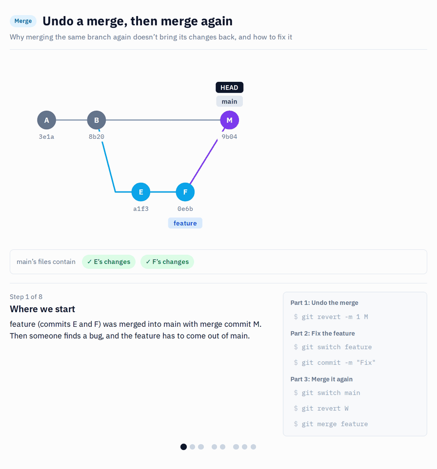

# s16 · Revert a merge commit

Module 5: Recovery · self-guided: you prepare the starting point yourself, no automatic check

## Why this matters



A whole feature was promoted with a merge, and it's wrong. `git revert -m 1 <merge commit>` undoes the full merge in one step. The `-m 1` tells git which side to keep, usually the branch you merged into.

One thing to know before you need it: if you revert a merge, then fix the feature and merge the same branch again, Git will only bring in the new commits. The original changes stay undone, because Git sees those commits as already merged. To bring them back, revert the revert first (`git revert <revert-commit>`), then merge again.

## What it looks like

The bad feature came in with one merge commit:

```
*   b10a8a9 Merge branch 's16/feature-bad' into s16/shared
|\
| * 49ec576 Sales Amount: use Unit Price
| * 802095c Add Average Order Value
| * f6041e4 Add Order Count
|/
* 4c33612 Baseline model
```

Revert the merge, telling git that parent 1 (the shared branch) is the line to keep:

```
$ git revert -m 1 b10a8a9
$ git log -1 --format=%B
Revert "Merge branch 's16/feature-bad' into s16/shared"

This reverts commit b10a8a965c9db21fbb606ac4c6640b4e4915458c, reversing
changes made to 4c33612857bcbfb047f35364166282aa2a2c796b.
```

All three commits are undone in one step, and the model is back to what it was before the merge.

The catch: later, the feature is fixed and someone tries to merge it again:

```
$ git merge s16/feature-bad
Already up to date.
```

Git thinks those commits are already in, because they are: they were merged and then reverted. To bring them back, revert the revert (`git revert <hash of the revert commit>`).

## Start

Starting point: `main`. You merge a bad feature yourself, then undo it.

## Steps

**Prepare**

1. Create `s16/shared` from `main`, then `s16/feature-bad` from it:
   ```bash
   git switch -c s16/shared main
   git switch -c s16/feature-bad
   ```
2. Make three commits in Power BI Desktop (save before each):
   - `Order Count = DISTINCTCOUNT ( Sales[Order Number] )`, commit `Add Order Count`
   - `Average Order Value = DIVIDE ( [Sales Amount], [Order Count] )`, commit `Add Average Order Value`
   - change `Sales Amount` to use `Sales[Unit Price]` instead of `Sales[Net Price]`, commit `Sales Amount: use Unit Price`
3. Merge it into shared with a merge commit:
   ```bash
   git switch s16/shared
   git merge --no-ff s16/feature-bad
   ```

**Undo the whole feature**

4. Find the merge commit:
   ```bash
   git log --merges --oneline -3
   ```
5. Revert it. Terminal only, VS Code can't revert a merge commit:
   ```bash
   git revert -m 1 <hash of the merge commit>
   ```
   `-m 1` means: keep the first parent, the branch you merged **into**.
6. In Desktop, click `Apply external changes`: `Order Count`, `Average Order Value` and the `Sales Amount` change are all gone.
7. Try merging the feature again and read what git says:
   ```bash
   git merge s16/feature-bad
   ```

## How to know it worked

- [ ] All three changes are gone from the model
- [ ] `git log --oneline -3` shows the revert commit on top of the merge commit
- [ ] Merging the feature again says `Already up to date.`
- [ ] `python tools/check.py s16` says all good (it checks the result for you)

## Tips

> Tip: To bring the feature back later, revert the revert commit. Merging the branch again won't do it.
