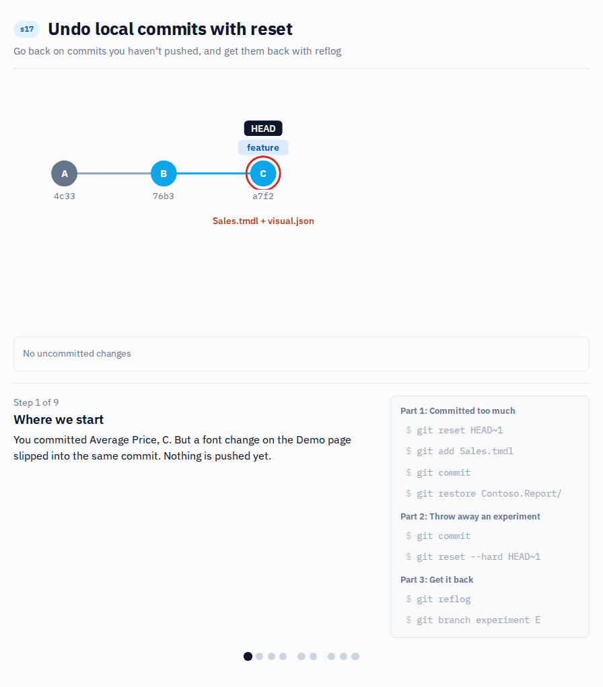

# s17 · Undo local commits with reset (and get them back with reflog)

Module 5: Recovery · self-guided: you prepare the starting point yourself, no automatic check

## Why this matters



In s15 you undid a commit with revert, because the commit was already on a shared branch and others had pulled it. But a lot of mistakes never leave your laptop. You committed too much, you committed too early, or you tried something in Desktop that didn't work out. For those, an extra "undo" commit in the history is overkill. You just want to go back, as if the commit never happened. That's what `git reset` is for.

Reset moves your branch back to an earlier commit, and the commits after it disappear from the branch. What happens with their changes depends on the option you choose:

| Command | The commit | The changes in it |
|---|---|---|
| `git reset --soft HEAD~1` | undone | kept and still staged, ready to commit again |
| `git reset HEAD~1` (`--mixed`, the default) | undone | kept in your files, but unstaged |
| `git reset --hard HEAD~1` | undone | thrown away, your files go back to the earlier commit |

`HEAD~1` means "one commit before where I am now", `HEAD~2` is two back. You can also use a commit hash.

The rule is the same as with rebase in s10: reset rewrites history. Use it on commits you haven't pushed yet, or on a branch only you work on. Once a commit is on a shared branch, use revert (s15).

And if you reset too far, the commit usually isn't lost. Git keeps a log of every place your branch has been, the reflog, and a commit you reset away stays reachable from there for at least 30 days by default. The reflog only lives on your laptop, though, and it only knows about commits. Changes you never committed are gone for good after a `--hard` reset.

## What it looks like

**Committed too much.** The commit should only have the new measure, but a font change on the Demo page slipped in:

```
$ git show --stat --format=%s HEAD
Add Average Price

 .../visuals/600e50304b3c610932cc/visual.json        | 2 +-
 Contoso.SemanticModel/definition/tables/Sales.tmdl  | 4 ++++
 2 files changed, 5 insertions(+), 1 deletion(-)
```

Undo the commit, keep the changes, then commit only the model file again:

```
$ git reset HEAD~1
Unstaged changes after reset:
M	Contoso.Report/definition/pages/ReportSection41f6331ebecdd8974b00/visuals/600e50304b3c610932cc/visual.json
M	Contoso.SemanticModel/definition/tables/Sales.tmdl
```

**Throw away an experiment.** The last commit was a bad idea:

```
$ git log --oneline -3
15c7b64 Sales Amount: try Unit Price
4423b67 Add Average Price
76b31f6 Add Order Count

$ git reset --hard HEAD~1
HEAD is now at 4423b67 Add Average Price
```

**Changed your mind?** The reflog still knows the commit:

```
$ git reflog -3
4423b67 HEAD@{0}: reset: moving to HEAD~1
15c7b64 HEAD@{1}: commit: Sales Amount: try Unit Price
4423b67 HEAD@{2}: commit: Add Average Price

$ git branch s17/experiment 15c7b64
```

*Commit hashes will be different on your machine.*

## Start

Starting point: `main`. Everything happens on your own branch, nothing gets pushed.

## Steps

**Prepare**

1. Create your branch from `main`:
   ```bash
   git switch -c s17/feature main
   ```
2. In Power BI Desktop, add `Order Count = DISTINCTCOUNT ( Sales[Order Number] )`. Save, commit `Add Order Count`.

**Committed too much: `--mixed`**

3. In Desktop, add `Average Price = DIVIDE ( [Sales Amount], [Total Quantity] )`. On the `Demo` page, also make the table's font smaller: this is the change that shouldn't be in the commit. Save and commit everything as `Add Average Price`:
   ```bash
   git add .
   git commit -m "Add Average Price"
   ```
4. Look at the commit (click it in the Source Control Graph, or `git show --stat HEAD`). Two files, but only `Sales.tmdl` should be there.
5. Undo the commit and keep the changes:

   **VS Code UI:** In the Source Control panel open the `...` menu, select `Commit` > `Undo Last Commit`. This is the `--soft` version: the changes stay staged, so unstage `visual.json` with the `-` button next to it.

   **Terminal:**
   ```bash
   git reset HEAD~1
   ```
6. Stage only `Sales.tmdl` and commit it again as `Add Average Price`. Then throw away the font change:

   **VS Code UI:** Right-click `visual.json` > `Discard Changes`.

   **Terminal:**
   ```bash
   git restore Contoso.Report/
   ```

**Throw away an experiment: `--hard`**

7. In Desktop, click `Apply external changes` first, so the font change is gone there too. Then change `Sales Amount` to use `Sales[Unit Price]` instead of `Sales[Net Price]`. Save, commit `Sales Amount: try Unit Price`.
8. You decide it was a bad idea. Throw the commit away. Terminal only, there's no button for a hard reset in VS Code:
   ```bash
   git reset --hard HEAD~1
   ```
9. In Desktop, click `Apply external changes`: `Sales Amount` uses `Net Price` again, and the commit is gone from the graph.

**Get it back: reflog**

10. Find the lost commit in the reflog:
    ```bash
    git reflog -5
    ```
    Look for `commit: Sales Amount: try Unit Price` and copy its hash.
11. Put a branch on it, so it's easy to find again:
    ```bash
    git branch s17/experiment <hash>
    git log --oneline -3 s17/experiment
    ```
    The experiment is back on its own branch, and `s17/feature` stays clean.

## How to know it worked

- [ ] `s17/feature` has `Add Order Count` and `Add Average Price`, and `Add Average Price` only changes `Sales.tmdl`
- [ ] `Sales Amount` on `s17/feature` still uses `Net Price`
- [ ] `s17/experiment` has the `Sales Amount: try Unit Price` commit
- [ ] Nothing was pushed
- [ ] `python tools/check.py s17` says all good (it checks the result for you)

## Tips

> Tip: After a reset, click `Apply external changes` in Desktop before anything else. If you save first, Desktop writes the version you just threw away back to the files.

> Tip: `--hard` also throws away changes you haven't committed, and those can't be found in the reflog. If you're not sure, commit or `git stash` first.

> Tip: Already pushed to a branch only you use? Reset, then `git push --force-with-lease` (see s10). On a shared branch, use revert (s15).

> Tip: `git reset --soft HEAD~3` followed by one commit turns your last three commits into one. That's a quick local squash (s09).
